# Arquitetura - Terraform na Prática: coleções do Terraform com count, for_each e expressões for

Cada serviço abaixo traz: finalidade, recurso Terraform, código real, argumentos, dependências, segurança, papel no fluxo, verificação e como alterar ou remover. O código está em [`terraform/`](terraform/).

## Visão geral

```
                       ┌─────────────── us-east-1 (ACM) ───────────────┐
                       │ Certificado já existente (somente leitura)    │
                       └───────────────────────┬───────────────────────┘
                                               │ (opcional)
Route 53 (Hosted Zone existente)               │
  galeria.exemplo.com.br  A/AAAA Alias ───────►│
                                               ▼
Navegador ──HTTPS──────────────────────► CloudFront ──SigV4 (OAC)──► S3 privado
                    HTTP redireciona                (cache)           (endpoint REST)
                    para HTTPS                                         bucket policy:
                                                                       só esta distribuição
```

Ordem de criação deduzida pelo Terraform:

```
aws_s3_bucket.frontend ──► public_access_block / ownership / encryption ──► aws_s3_object.site[*]
         │
         ├────────────────────────────┐
aws_cloudfront_origin_access_control ─┴─► aws_cloudfront_distribution.site ─► aws_s3_bucket_policy.frontend
                                                     └────────────────────► aws_route53_record.* (se habilitado)
```

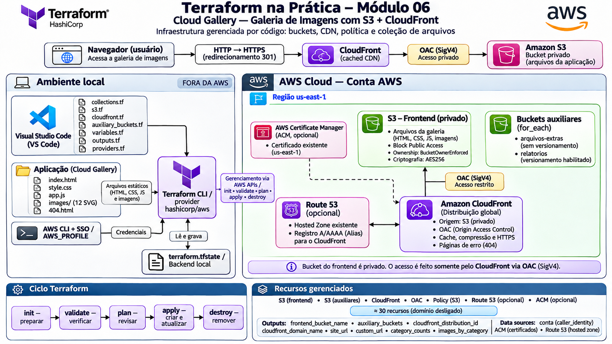

*Figura 1 — Arquitetura do Módulo 06: S3 privado, CloudFront com OAC e domínio opcional (Route 53 e ACM).*

---

## 1. Amazon S3: bucket do frontend

### 1.1 Finalidade

Armazenar os arquivos da galeria. O bucket é a **origem** dos dados e nunca é público. Quem o lê é o CloudFront.

### 1.2 Recursos

`aws_s3_bucket`, `aws_s3_bucket_public_access_block`, `aws_s3_bucket_ownership_controls`, `aws_s3_bucket_server_side_encryption_configuration` (arquivo `s3.tf`).

### 1.3 Código

```hcl
locals {
  bucket_prefix = "${var.project_name}-m06-${data.aws_caller_identity.current.account_id}-${var.aws_region}"
  frontend_name = local.bucket_prefix
}

resource "aws_s3_bucket" "frontend" {
  bucket        = local.frontend_name
  force_destroy = true

  tags = {
    Name       = "${local.frontend_name}"
    CostCenter = "laboratorio"
  }

  lifecycle {
    ignore_changes = [tags["CostCenter"]]
    # prevent_destroy = true   <- comentado de propósito (ver README)
  }
}

resource "aws_s3_bucket_public_access_block" "frontend" {
  bucket                  = aws_s3_bucket.frontend.id
  block_public_acls       = true
  ignore_public_acls      = true
  block_public_policy     = true
  restrict_public_buckets = true
}

resource "aws_s3_bucket_ownership_controls" "frontend" {
  bucket = aws_s3_bucket.frontend.id
  rule {
    object_ownership = "BucketOwnerEnforced"
  }
}

resource "aws_s3_bucket_server_side_encryption_configuration" "frontend" {
  bucket = aws_s3_bucket.frontend.id
  rule {
    apply_server_side_encryption_by_default {
      sse_algorithm = "AES256"
    }
    bucket_key_enabled = true
  }
}
```

### 1.4 Argumentos principais

| Argumento | Tipo de valor | Efeito |
|---|---|---|
| `bucket` | Valor montado (variável + data source) | Nome **global e único**; contém a conta e a região para não colidir |
| `force_destroy` | Fixo | Permite apagar o bucket com objetos no `destroy` |
| `tags` | Fixo | `Name` e `CostCenter`; `Project`, `Environment`, `ManagedBy` vêm do `default_tags` |
| `block_public_*` / `ignore_public_acls` / `restrict_public_buckets` | Fixos | Quatro travas do Block Public Access |
| `object_ownership = "BucketOwnerEnforced"` | Fixo | Desativa as ACLs: só políticas controlam acesso |
| `sse_algorithm = "AES256"` | Fixo | Criptografia padrão gerenciada pelo S3 |
| `bucket` (nos recursos filhos) | Referência (`aws_s3_bucket.frontend.id`) | Associa a configuração ao bucket |

Não existe `aws_s3_bucket_website_configuration`: **Static Website Hosting fica desligado**. A origem privada com OAC exige o endpoint REST.

### 1.5 Dependências

Todos os recursos filhos referenciam `aws_s3_bucket.frontend.id`, então esperam a criação do bucket.

### 1.6 Segurança

Quatro camadas: Block Public Access, ACLs desativadas, criptografia em repouso e política que libera só o CloudFront. O `ignore_changes` não afeta segurança: apenas uma tag de custo.

### 1.7 Papel no fluxo

Guarda os arquivos. Responde ao CloudFront quando este pede um objeto com assinatura válida.

### 1.8 Como verificar

```powershell
terraform output frontend_bucket_name
aws s3api get-public-access-block --bucket <bucket>
aws s3api get-bucket-ownership-controls --bucket <bucket>
aws s3api get-bucket-encryption --bucket <bucket>
aws s3api get-bucket-website --bucket <bucket>      # deve falhar: NoSuchWebsiteConfiguration
terraform state show aws_s3_bucket.frontend
```

### 1.9 Como alterar ou remover

- Tags e flags: alteração no lugar (`~`).
- **Nome do bucket** (`project_name`, `aws_region`): é *force new*. O plan mostra `-/+` no bucket, nos objetos e na policy, porque o S3 não permite renomear buckets.
- Remover: `terraform destroy` (o `force_destroy` esvazia antes).

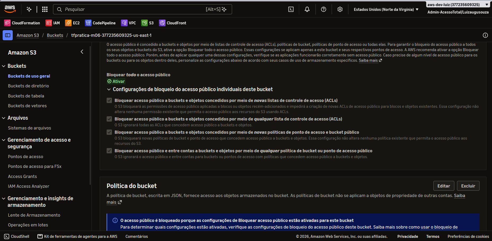

*Figura 2 — Bloqueio de acesso público habilitado no bucket do frontend.*

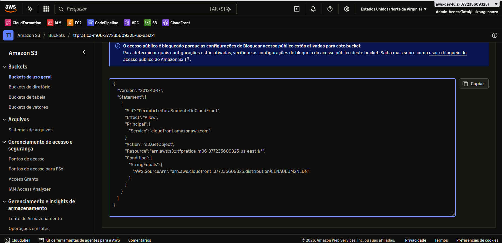

*Figura 3 — Bucket policy permitindo a leitura somente pelo CloudFront (OAC).*

---

## 2. Amazon S3: objetos do frontend

### 2.1 Finalidade

Publicar HTML, CSS, JavaScript e imagens com o `Content-Type` correto e detectar mudanças de conteúdo.

### 2.2 Recurso

`aws_s3_object` com `for_each` (arquivo `s3.tf`).

### 2.3 Código

```hcl
locals {
  site_files = fileset(local.application_path, "**")
  content_types = {
    ".html" = "text/html; charset=utf-8"
    ".css"  = "text/css; charset=utf-8"
    ".js"   = "application/javascript; charset=utf-8"
    ".svg"  = "image/svg+xml"
    # ...
  }
}

resource "aws_s3_object" "site" {
  for_each = local.site_files

  bucket      = aws_s3_bucket.frontend.id
  key         = each.value
  source      = "${local.application_path}/${each.value}"
  source_hash = filemd5("${local.application_path}/${each.value}")

  content_type = lookup(
    local.content_types,
    try(regex("\\.[^.]+$", each.value), ""),
    "application/octet-stream"
  )

  depends_on = [aws_s3_bucket_server_side_encryption_configuration.frontend]
}
```

### 2.4 Argumentos principais

| Argumento | Tipo de valor | Efeito |
|---|---|---|
| `for_each` | Conjunto vindo de `fileset` | Uma instância por arquivo; `each.value` é o caminho relativo |
| `key` | `each.value` | Caminho do objeto no bucket (`images/cidade-01-noite.svg`) |
| `source` | Caminho local | Arquivo lido pelo Terraform na hora do `apply` |
| `source_hash` | Computado por `filemd5` | Se o arquivo mudar, o hash muda e o objeto é reenviado |
| `content_type` | Expressão (`lookup` + `regex` + `try`) | Extensão → tipo MIME; sem isso o navegador não renderiza SVG/CSS/JS corretamente |

Endereços no state: `aws_s3_object.site["index.html"]`, `aws_s3_object.site["images/cidade-01-noite.svg"]`.

### 2.5 Dependências

Bucket (`.id`) e o `depends_on` para a criptografia (garante que os objetos já nasçam sob a configuração padrão).

### 2.6 Papel no fluxo

É o "deploy" da aplicação: o `terraform apply` faz o upload. Não há pipeline separado.

### 2.7 Como verificar

```powershell
terraform state list | Select-String "aws_s3_object.site"
aws s3api head-object --bucket <bucket> --key images/cidade-01-noite.svg
```

Confira `ContentType: image/svg+xml` e `ServerSideEncryption: AES256`.

### 2.8 Como alterar ou remover

- **Editar um arquivo** → `~ update in-place` (novo `source_hash`).
- **Adicionar arquivo** em `application/` → `+ create` de uma instância nova.
- **Apagar arquivo** da pasta *depois* de aplicado → `- destroy` do objeto.
- Atualizar o S3 **não atualiza o cache do CloudFront**. Veja a seção 4.8.

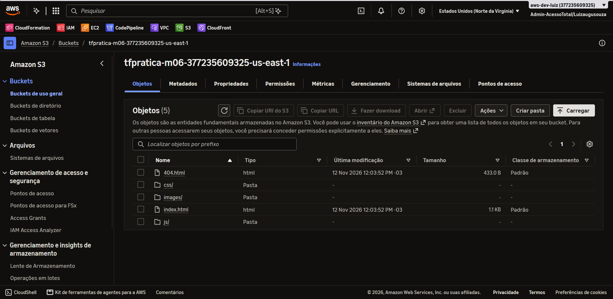

*Figura 4 — Objetos do frontend no bucket S3.*

---

## 3. Amazon S3: buckets auxiliares (recursos dinâmicos)

### 3.1 Finalidade

Estudar `for_each`, `count` e condicionais. A aplicação **não usa** estes buckets.

### 3.2 Recursos

`aws_s3_bucket.auxiliary`, `aws_s3_bucket_public_access_block.auxiliary`, `aws_s3_bucket_versioning.auxiliary`, `aws_s3_object.auxiliary_readme` (arquivo `auxiliary_buckets.tf`).

### 3.3 Código

```hcl
variable "auxiliary_buckets" {
  type = map(object({
    purpose    = string
    versioning = bool
  }))
  default = {
    "arquivos-extras" = { purpose = "Arquivos extras de demonstração", versioning = false }
    "relatorios"      = { purpose = "Relatórios de demonstração (com versionamento)", versioning = true }
  }
}

resource "aws_s3_bucket" "auxiliary" {
  for_each = var.auxiliary_buckets

  bucket        = "${local.bucket_prefix}-${each.key}"
  force_destroy = true
  tags = {
    Purpose = each.value.purpose
  }
}

resource "aws_s3_bucket_public_access_block" "auxiliary" {
  for_each = aws_s3_bucket.auxiliary
  bucket   = each.value.id
  # ... quatro flags true
}

resource "aws_s3_bucket_versioning" "auxiliary" {
  for_each = { for k, v in var.auxiliary_buckets : k => v if v.versioning }
  bucket   = aws_s3_bucket.auxiliary[each.key].id
  versioning_configuration {
    status = "Enabled"
  }
}

locals {
  auxiliary_keys = sort(keys(var.auxiliary_buckets))
}

resource "aws_s3_object" "auxiliary_readme" {
  count  = length(local.auxiliary_keys)
  bucket = aws_s3_bucket.auxiliary[local.auxiliary_keys[count.index]].id
  key    = "LEIA-ME.txt"
  # ...
}
```

### 3.4 Como ler este código

| Elemento | Significado |
|---|---|
| `for_each = var.auxiliary_buckets` | Uma instância por chave do mapa |
| `each.key` | `"arquivos-extras"` e `"relatorios"` (entra no nome do bucket) |
| `each.value` | O objeto `{ purpose, versioning }` da chave atual |
| `for_each = aws_s3_bucket.auxiliary` | Itera sobre o **mapa de recursos** criado acima: o encadeamento mais comum |
| `if v.versioning` | Condicional dentro do `for`: só `relatorios` entra no mapa |
| `count = length(...)` / `count.index` | Instâncias numeradas `[0]`, `[1]` sobre uma **lista** |
| `sort(keys(...))` | Torna a ordem da lista previsível para o `count` |
| `precondition` no bucket | Barra o `plan` se `"<prefixo>-<chave>"` passar de 63 caracteres |

### 3.5 Quais recursos são criados ou removidos quando a coleção muda

| Mudança em `auxiliary_buckets` | Criado | Removido |
|---|---|---|
| Adicionar `"backup"` | bucket `backup`, seu bloqueio público, seu `LEIA-ME.txt` (e versionamento, se `true`) | nada |
| Remover `"arquivos-extras"` | nada | bucket, bloqueio público e `LEIA-ME` dele. No `count`, `relatorios` muda de `[1]` para `[0]`, e o Terraform atualiza/recria objetos por causa do deslocamento |
| `versioning` de `relatorios` → `false` | nada | `aws_s3_bucket_versioning.auxiliary["relatorios"]` |
| Renomear a chave `"relatorios"` → `"logs"` | bucket `logs` | bucket `relatorios` (a chave **é** a identidade; o nome do bucket também muda) |

### 3.6 Segurança

Privados por padrão (bloqueio público). Sem policy. Criptografia SSE-S3 é aplicada automaticamente pelo S3 em buckets novos.

### 3.7 Verificação, alteração e remoção

```powershell
terraform output auxiliary_buckets
terraform state list | Select-String "auxiliary"
terraform console
> var.auxiliary_buckets
> aws_s3_bucket.auxiliary["relatorios"].bucket
```

Altere o `terraform.tfvars`, rode `terraform plan` e compare com a tabela da seção 3.5. Remova com `terraform destroy` (o `force_destroy` esvazia os buckets, inclusive versões).

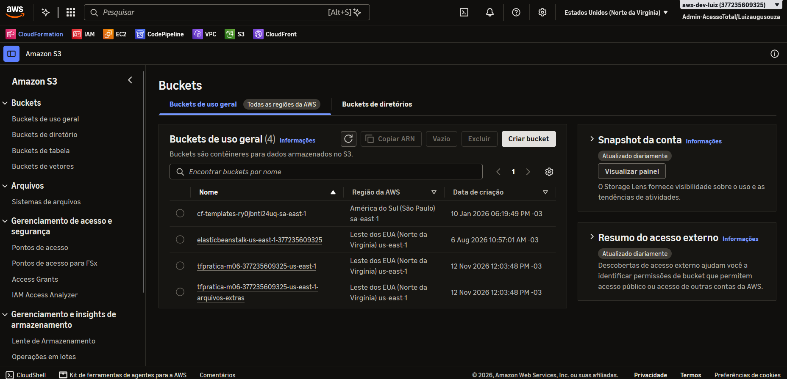

*Figura 5 — Lista de buckets S3 com o bucket do frontend e os buckets auxiliares.*

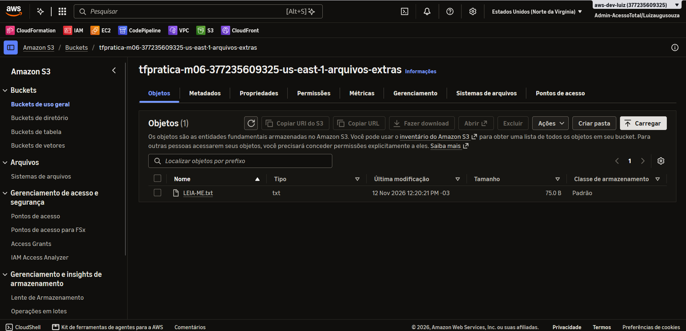

*Figura 6 — Bucket auxiliar de arquivos extras no console do S3.*

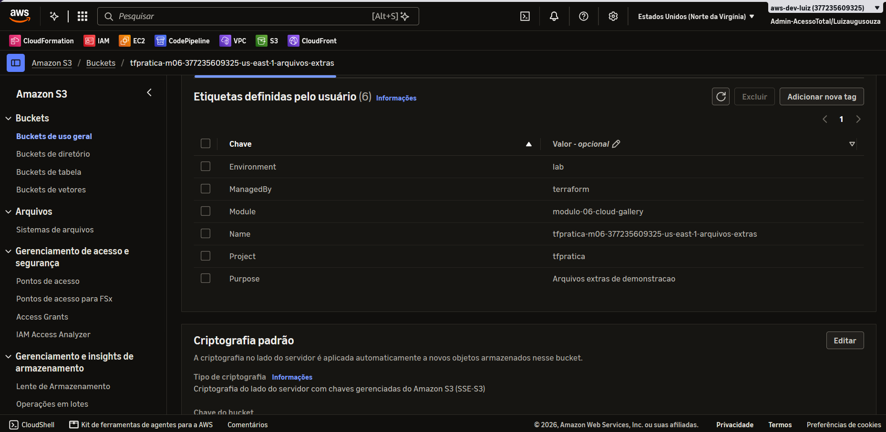

*Figura 7 — Tags do bucket auxiliar geradas a partir da coleção.*

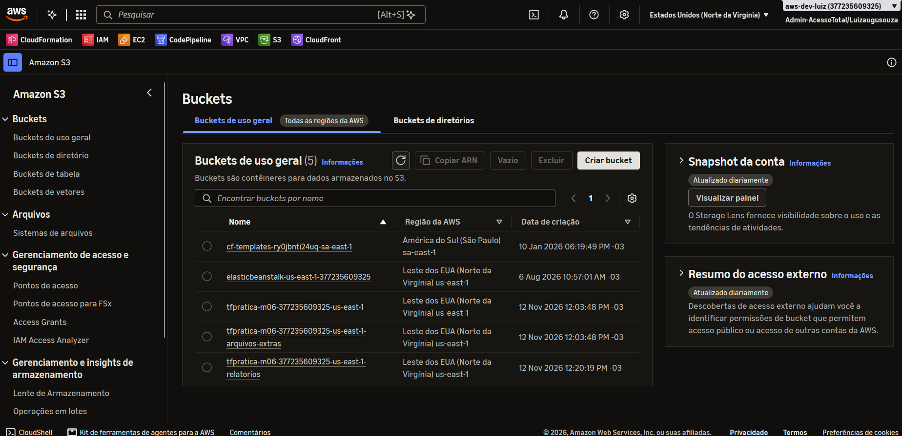

*Figura 8 — Lista completa de buckets S3 antes de testar o prevent_destroy.*

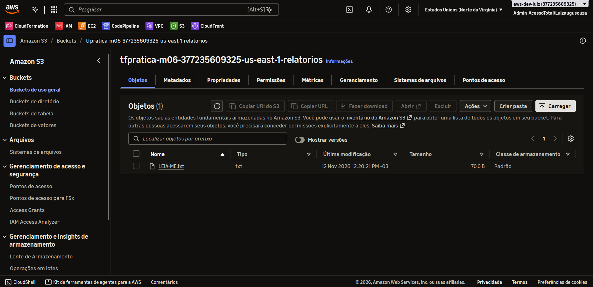

*Figura 9 — Objetos do bucket de relatórios no console do S3.*

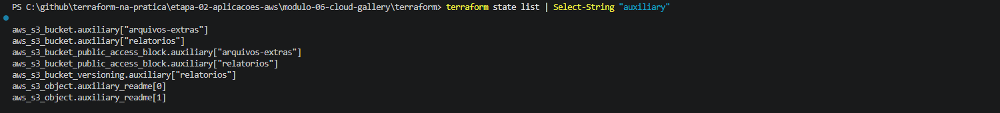

*Figura 10 — terraform state list mostrando os endereços dos buckets auxiliares.*

---

## 4. Amazon CloudFront, OAC e bucket policy

### 4.1 Finalidade

Entregar o site por HTTPS com cache global e proteger a origem S3.

### 4.2 Recursos

`aws_cloudfront_origin_access_control`, `aws_cloudfront_distribution`, `aws_s3_bucket_policy`, `data.aws_cloudfront_cache_policy`, `data.aws_iam_policy_document` (arquivo `cloudfront.tf`).

### 4.3 Código

```hcl
data "aws_cloudfront_cache_policy" "caching_optimized" {
  name = "Managed-CachingOptimized"
}

resource "aws_cloudfront_origin_access_control" "site" {
  name                              = "${var.project_name}-m06-oac"
  origin_access_control_origin_type = "s3"
  signing_behavior                  = "always"
  signing_protocol                  = "sigv4"
}

resource "aws_cloudfront_distribution" "site" {
  enabled             = true
  default_root_object = "index.html"
  price_class         = var.price_class
  is_ipv6_enabled     = var.enable_ipv6
  aliases             = local.custom_aliases

  origin {
    origin_id                = "s3-frontend"
    domain_name              = aws_s3_bucket.frontend.bucket_regional_domain_name
    origin_access_control_id = aws_cloudfront_origin_access_control.site.id
  }

  default_cache_behavior {
    target_origin_id       = "s3-frontend"
    viewer_protocol_policy = "redirect-to-https"
    allowed_methods        = ["GET", "HEAD"]
    cached_methods         = ["GET", "HEAD"]
    compress               = true
    cache_policy_id        = data.aws_cloudfront_cache_policy.caching_optimized.id
  }

  dynamic "custom_error_response" {
    for_each = var.error_pages
    content {
      error_code         = tonumber(custom_error_response.key)
      response_code      = custom_error_response.value.response_code
      response_page_path = custom_error_response.value.page_path
    }
  }
  # ... restrictions e viewer_certificate (dynamic)
}

data "aws_iam_policy_document" "frontend" {
  statement {
    effect    = "Allow"
    actions   = ["s3:GetObject"]
    resources = ["${aws_s3_bucket.frontend.arn}/*"]
    principals {
      type        = "Service"
      identifiers = ["cloudfront.amazonaws.com"]
    }
    condition {
      test     = "StringEquals"
      variable = "AWS:SourceArn"
      values   = [aws_cloudfront_distribution.site.arn]
    }
  }
}

resource "aws_s3_bucket_policy" "frontend" {
  bucket     = aws_s3_bucket.frontend.id
  policy     = data.aws_iam_policy_document.frontend.json
  depends_on = [aws_s3_bucket_public_access_block.frontend]
}
```

### 4.4 Argumentos principais

| Argumento | Tipo de valor | Efeito na AWS |
|---|---|---|
| `signing_behavior = "always"` / `signing_protocol = "sigv4"` | Fixos | O CloudFront assina toda requisição ao S3 |
| `domain_name` (origem) | Referência (computado do bucket) | Endpoint **REST regional** `bucket.s3.<região>.amazonaws.com` |
| `origin_access_control_id` | Referência (computado) | Liga a origem ao OAC |
| `default_root_object` | Fixo | `/` entrega `/index.html` |
| `viewer_protocol_policy = "redirect-to-https"` | Fixo | HTTP recebe redirecionamento para HTTPS |
| `allowed_methods` / `cached_methods` | Fixos | Site estático só precisa de `GET` e `HEAD` |
| `cache_policy_id` | Referência a data source | Política gerenciada de cache (TTL padrão de 24 h) |
| `price_class` | Variável | `PriceClass_100`: menos locais de borda, menor custo |
| `is_ipv6_enabled` | Variável | IPv6 na borda |
| `aliases` | Referência a local | Lista vazia sem domínio; `[fqdn]` com domínio |
| `custom_error_response` (via `dynamic`) | Referência a variável (`var.error_pages`) | Um bloco por código de erro. Chave inexistente no S3 privado retorna 403; mostramos `404.html` com status 404 |
| `AWS:SourceArn` | Referência (computado) | Restringe a leitura à distribuição específica |

Nenhum recurso opcional pago foi habilitado: sem WAF, sem logging, sem Lambda@Edge, sem *origin shield*, sem certificado dedicado.

### 4.5 Origem S3 x acesso público

| | Origem (S3) | Acesso público (CloudFront) |
|---|---|---|
| Endereço | `<bucket>.s3.<região>.amazonaws.com` | `<id>.cloudfront.net` ou seu domínio |
| Quem pode ler | Só o CloudFront (pela policy) | Qualquer pessoa na internet |
| Protocolo | Requisição assinada (SigV4) | HTTPS (HTTP é redirecionado) |
| Resposta a acesso direto | `403 AccessDenied` | 200 com o site |

### 4.6 Como o Terraform resolve as referências

1. O OAC e o bucket não dependem de nada entre si.
2. A distribuição lê `aws_s3_bucket.frontend.bucket_regional_domain_name` e `aws_cloudfront_origin_access_control.site.id`.
3. O data source `aws_iam_policy_document.frontend` lê `aws_cloudfront_distribution.site.arn`, que só existe após a criação da distribuição. O Terraform entende que o data só pode ser avaliado depois, e a policy depois dele.

No plan, a policy aparece com `policy = (known after apply)`.

### 4.7 Segurança

- Bucket sem acesso público e policy limitada a **uma** distribuição.
- Permissão única: `s3:GetObject`. Sem `ListBucket`, o chute de nomes de arquivo não revela o que existe.
- Com domínio personalizado, a política mínima de TLS é `TLSv1.2_2021`. Com o certificado padrão `*.cloudfront.net`, a AWS define o protocolo mínimo e ele não é configurável.

### 4.8 Como verificar, atualizar e remover

```powershell
terraform output
curl.exe -I $(terraform output -raw site_url)                        # 200, content-type: text/html
curl.exe -I http://$(terraform output -raw cloudfront_domain_name)   # 301 para https
curl.exe -I "https://<bucket>.s3.<regiao>.amazonaws.com/index.html"  # 403
aws cloudfront get-distribution --id <id> --query "Distribution.Status"   # Deployed
terraform state show aws_cloudfront_distribution.site
terraform state show aws_s3_bucket_policy.frontend
```

**Atualizar conteúdo:** depois de `terraform apply` com arquivos novos, o CloudFront pode manter a cópia antiga em cache (até 24 h). Para ver na hora:

```powershell
aws cloudfront create-invalidation --distribution-id <id> --paths "/*"
# ou use: terraform output -raw invalidation_command
```

Invalidações têm custo após a cota gratuita mensal. Prefira `--paths` específicos (`/index.html`, `/js/gallery.js`).

**Alterar:** mudar `price_class`, `enable_ipv6` ou `aliases` é alteração no lugar (a distribuição passa por `InProgress` por alguns minutos). **Remover:** `terraform destroy`. A distribuição é desabilitada e depois excluída, e isso leva alguns minutos.

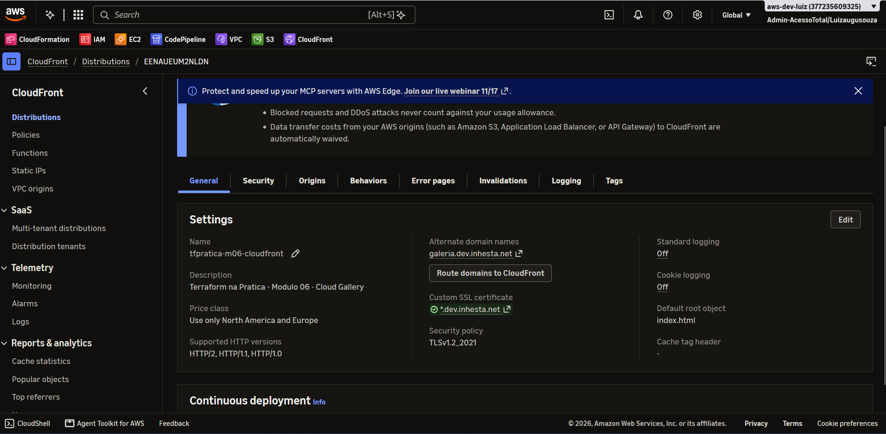

*Figura 11 — Distribuição do CloudFront no console da AWS.*

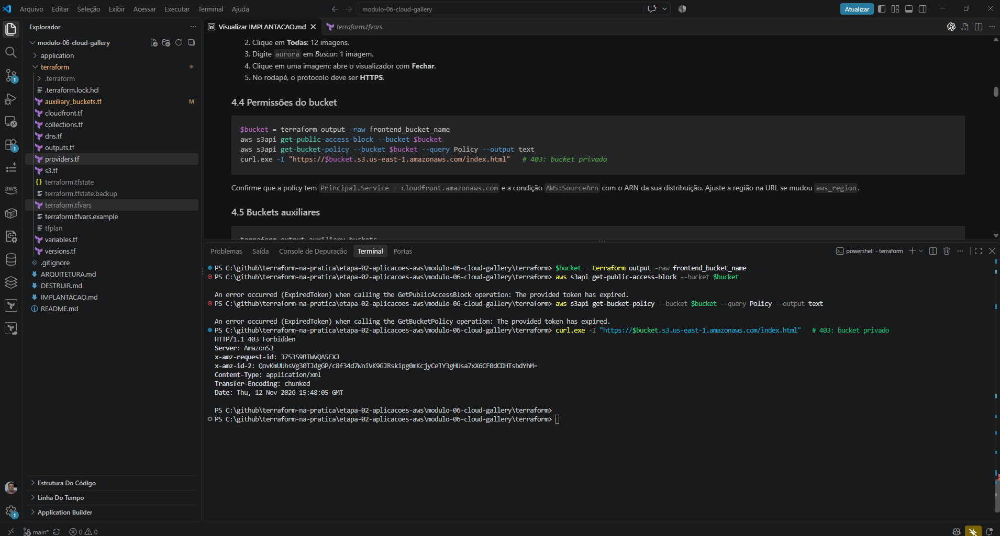

*Figura 12 — Acesso direto ao bucket retorna 403: o bucket é privado.*

---

## 5. Route 53 e ACM (domínio personalizado opcional)

### 5.1 Finalidade

Publicar a galeria em `galeria.seudominio` com HTTPS, **reaproveitando** Hosted Zone e certificado que você já possui. O endereço `*.cloudfront.net` continua funcionando.

### 5.2 Recursos e data sources

`data.aws_route53_zone`, `data.aws_acm_certificate` (com `provider = aws.us_east_1`), `aws_route53_record` (A e AAAA) e `aws_cloudfront_distribution.site` (aliases e certificado). Arquivo `dns.tf`.

### 5.3 Código

```hcl
data "aws_route53_zone" "existing" {
  count        = var.enable_custom_domain ? 1 : 0
  name         = var.hosted_zone_name
  private_zone = false
}

data "aws_acm_certificate" "existing" {
  provider    = aws.us_east_1
  count       = var.enable_custom_domain && var.certificate_arn == null ? 1 : 0
  domain      = var.certificate_domain_name
  statuses    = ["ISSUED"]
  most_recent = true
}

locals {
  certificate_arn    = !var.enable_custom_domain ? null : (
    var.certificate_arn != null ? var.certificate_arn : data.aws_acm_certificate.existing[0].arn
  )
  certificate_region = local.certificate_arn == null ? null : element(split(":", local.certificate_arn), 3)
  certificate_covers_fqdn = local.custom_fqdn != null && var.certificate_domain_name != null && contains(
    [local.custom_fqdn, local.wildcard_of_fqdn],
    lower(var.certificate_domain_name)
  )
}

resource "aws_route53_record" "alias_a" {
  count           = var.enable_custom_domain ? 1 : 0
  zone_id         = data.aws_route53_zone.existing[0].zone_id
  name            = local.custom_fqdn
  type            = "A"
  allow_overwrite = false

  alias {
    name                   = aws_cloudfront_distribution.site.domain_name
    zone_id                = aws_cloudfront_distribution.site.hosted_zone_id
    evaluate_target_health = false
  }
}
# aws_route53_record.alias_aaaa: idêntico, type = "AAAA", só com enable_ipv6 = true
```

No CloudFront, as `precondition` do bloco `lifecycle` barram o `plan` se: faltar `hosted_zone_name`/`certificate_domain_name`; o ARN do certificado não for de `us-east-1`; ou o certificado não cobrir o nome.

### 5.4 Argumentos principais

| Argumento | Tipo de valor | Efeito |
|---|---|---|
| `count = ... ? 1 : 0` | Condicional | Sem domínio, nada deste arquivo é criado nem consultado |
| `private_zone = false` | Fixo | Procura apenas Hosted Zone pública |
| `provider = aws.us_east_1` | Referência a provider com alias | Consulta o ACM em us-east-1, qualquer que seja `aws_region` |
| `statuses = ["ISSUED"]` | Fixo | Ignora certificados pendentes ou expirados |
| `allow_overwrite = false` | Fixo | Se o nome já existir, o `apply` **falha** em vez de sobrescrever (protege outros projetos) |
| `alias.zone_id` | Referência (`hosted_zone_id` da distribuição) | Zona fixa do CloudFront para registros Alias |
| `ssl_support_method = "sni-only"` | Fixo | Certificado sem custo de IP dedicado |

### 5.5 Validação da cobertura do nome

O ACM só informa o **nome principal** do certificado ao data source. Por isso você informa `certificate_domain_name` (por exemplo `*.exemplo.com.br`), e o Terraform confere se ele é o FQDN exato ou o curinga de **um nível** (`*.exemplo.com.br` cobre `galeria.exemplo.com.br`, mas não `a.galeria.exemplo.com.br`). Se o certificado foi emitido com o nome desejado apenas como SAN (nome alternativo), informe `certificate_arn` junto com o nome que ele cobre.

Limite honesto: esta checagem confia no nome que você declarou. A AWS ainda rejeitará o alias no `apply` se o certificado não o cobrir de verdade.

### 5.6 Segurança e isolamento

- Nenhuma Hosted Zone, domínio ou certificado é criado, alterado ou apagado. Eles são só lidos.
- O módulo cria apenas dois registros, em um nome próprio (`subdomain`).
- Cada módulo usa seu subdomínio (`galeria` no 06, `ambiente` no 07), sem acoplamento entre eles.
- O `destroy` remove só esses registros.

### 5.7 Papel no fluxo

O navegador resolve `galeria.exemplo.com.br` → Alias para `*.cloudfront.net` → CloudFront apresenta o certificado ACM → entrega o conteúdo.

### 5.8 Como verificar

```powershell
aws route53 list-hosted-zones-by-name --dns-name exemplo.com.br
aws acm list-certificates --region us-east-1 --certificate-statuses ISSUED `
  --query "CertificateSummaryList[].[DomainName,CertificateArn]"
aws route53 list-resource-record-sets --hosted-zone-id <zona> `
  --query "ResourceRecordSets[?Name=='galeria.exemplo.com.br.']"
Resolve-DnsName galeria.exemplo.com.br
curl.exe -I https://galeria.exemplo.com.br
```

### 5.9 Como alterar ou remover

- Mudar `subdomain`: o registro é substituído (`name` é *force new*) e a distribuição atualiza `aliases`.
- `enable_custom_domain = false`: o `plan` destrói os registros e remove os aliases. O endereço `cloudfront.net` continua.
- Um alias não pode estar em duas distribuições ao mesmo tempo (`CNAMEAlreadyExists`).

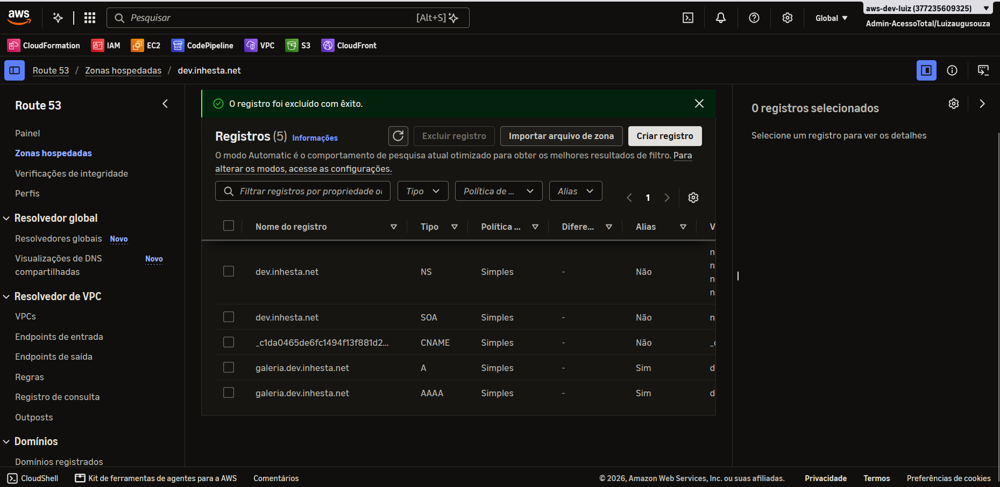

*Figura 13 — Registros do Route 53 criados pelo Terraform.*

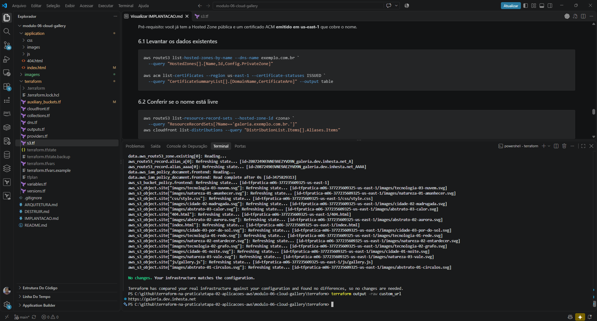

*Figura 14 — Plan com o domínio personalizado sem mudanças.*

---

## 6. Coleções e expressões for (`collections.tf`)

### 6.1 Finalidade

Mostrar os tipos de coleção e as formas de transformá-las. O arquivo **não cria recursos**: só `locals`, que podem ser inspecionados com `terraform console` e aparecem em três outputs.

### 6.2 Tipos de coleção

| Local | Tipo | Observação |
|---|---|---|
| `example_list` | `list(string)` | `tolist(["a","b","a"])`: ordenada, com repetição |
| `example_set` | `set(string)` | `toset(...)`: sem repetição, sem ordem |
| `example_map` | `map(string)` | `tomap({...})`: acesso por chave |
| `example_object` | `object` | atributos de tipos diferentes |
| `example_tuple` | `tuple` | tipos mistos por posição |

Um literal `["a", "b"]` é uma tuple. `for_each` recusa lista e tuple; aceita `map` e `set`.

### 6.3 Expressões for sobre as 12 imagens

| Local | Padrão | Resultado |
|---|---|---|
| `image_files` | lista → lista, com `if` | 12 caminhos `images/...` |
| `gallery_images` | lista → lista de objetos | `{ file, category }`; categoria vem de `split("-", basename(f))[0]` |
| `image_index` | lista → mapa | arquivo → categoria |
| `images_by_category` | lista → mapa agrupado (`...`) | categoria → lista de arquivos |
| `category_counts` | mapa → mapa | 3 imagens por categoria |
| `category_names` | mapa → lista | `abstrato`, `cidade`, `natureza`, `tecnologia` |
| `city_images` | filtro com `if` | 3 arquivos da categoria `cidade` |

Dependência: `local.site_files` (em `s3.tf`) vem de `fileset()`. Não há recurso envolvido, então tudo é conhecido no `plan`.

### 6.4 Verificação

```powershell
terraform console
> local.category_counts
> local.images_by_category
terraform output category_counts
terraform output collection_types_demo
```

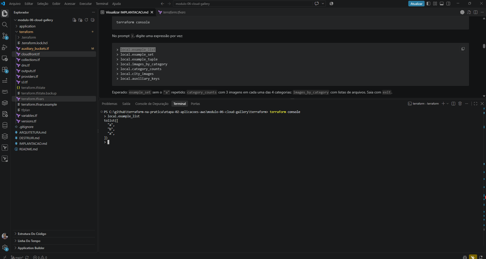

*Figura 15 — Lista e conjunto (set) avaliados no terraform console.*

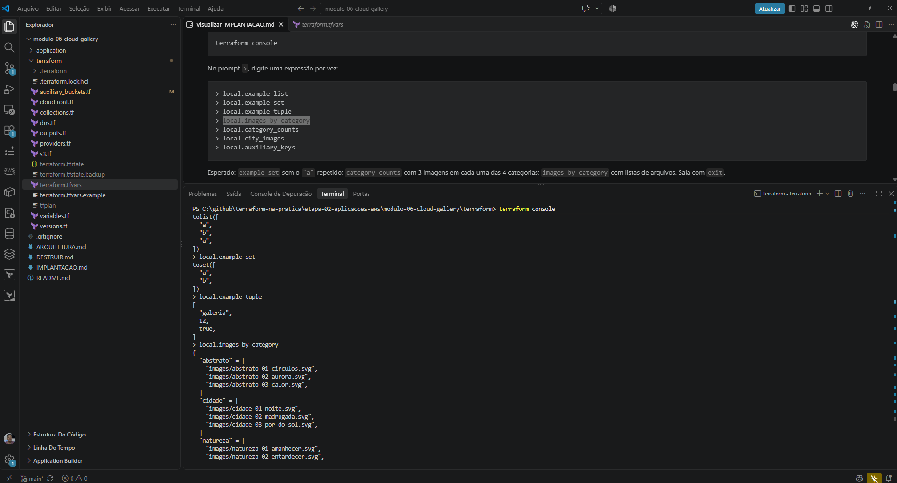

*Figura 16 — Tupla e categorias avaliadas no terraform console.*

---

## 7. dynamic: blocos aninhados a partir de coleção

| Uso | Onde | Entrada | Efeito |
|---|---|---|---|
| Repetição | `custom_error_response` em `cloudfront.tf` | `var.error_pages` (`map(object)`) | Um bloco por entrada; iterador `custom_error_response.key` e `.value` |
| Interruptor | `viewer_certificate` em `cloudfront.tf` | lista vazia ou `[1]` conforme `enable_custom_domain` | Liga ou desliga cada variante do bloco |

Adicionar `"500" = { response_code = 500, page_path = "/404.html" }` em `error_pages` faz o plan mostrar `~ aws_cloudfront_distribution.site` com um bloco a mais. Nada é recriado.

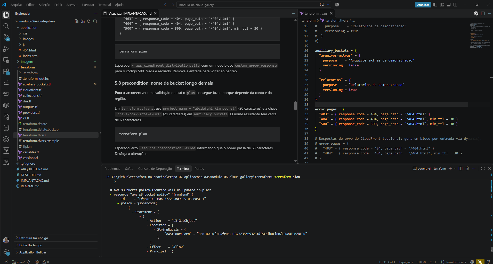

*Figura 17 — Plan do bloco dynamic adicionando uma página de erro.*

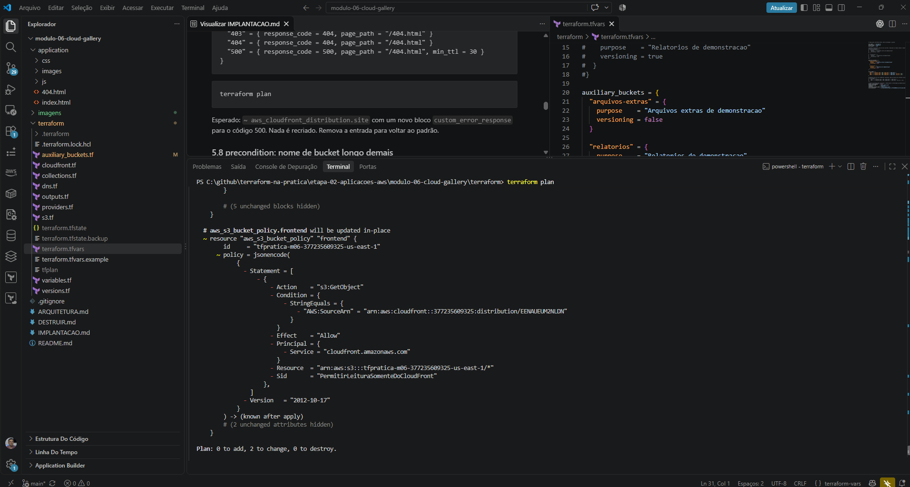

*Figura 18 — Resumo do plan com as páginas de erro geradas pelo dynamic.*

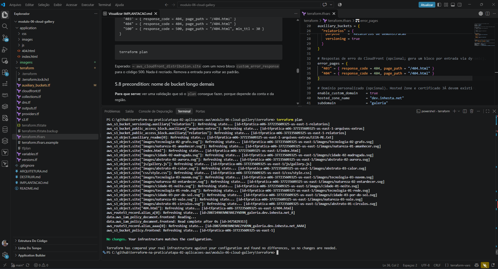

*Figura 19 — Plan sem mudanças após retornar à configuração original.*

---
## 8. Lifecycle

| Recurso | Argumento | Por quê |
|---|---|---|
| `aws_s3_bucket.frontend` | `ignore_changes = [tags["CostCenter"]]` | Tag que outro processo pode alterar; o plan não tenta revertê-la |
| `aws_s3_bucket.frontend` | `prevent_destroy` (comentado) | Protege contra `destroy` acidental; desligado para o laboratório poder ser removido |
| `aws_cloudfront_distribution.site` | `precondition` | Valida região e cobertura do certificado antes do `apply` |
| `aws_s3_bucket.auxiliary` | `precondition` | Nome do bucket com até 63 caracteres (depende de conta e região, por isso só o plan enxerga) |
| `aws_s3_object.auxiliary_readme` | `create_before_destroy` (comentado, **contraexemplo**) | Mesma chave no mesmo bucket: o apagamento do antigo removeria o novo |
| Buckets, OAC | `create_before_destroy` **não** usado | Nomes únicos: o novo colidiria com o antigo |

**Nomes de bucket e substituição.** `bucket` é *force new*. Se o nome mudar, o Terraform destrói o bucket e cria outro. Por isso o nome é montado com valores estáveis (projeto, conta, região) e não deve ser alterado casualmente.

**Testar `prevent_destroy`:** descomente a linha, rode `terraform plan -destroy` e leia `Instance cannot be destroyed`. Em seguida comente de novo, senão o laboratório não poderá ser removido.

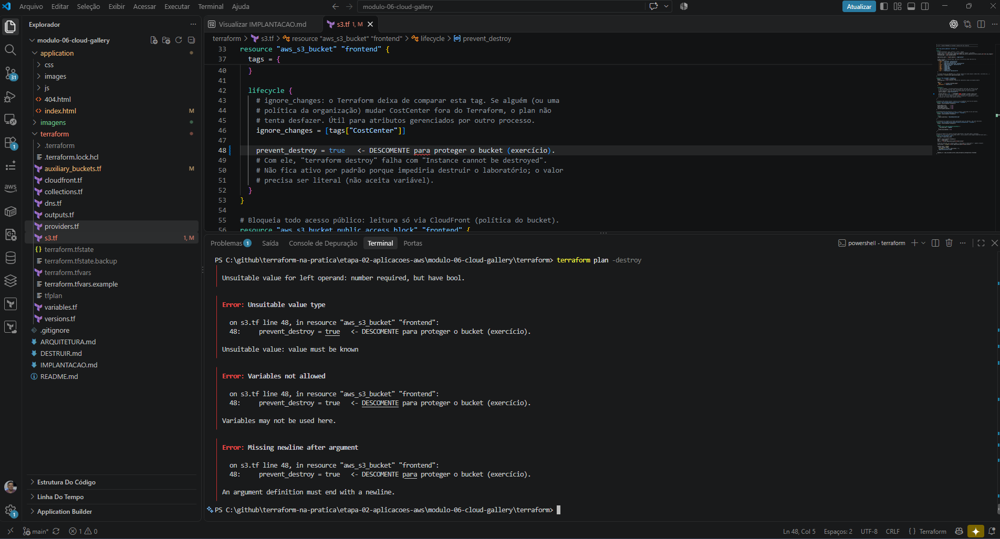

*Figura 20 — Erro de sintaxe ao descomentar o prevent_destroy de forma incorreta.*

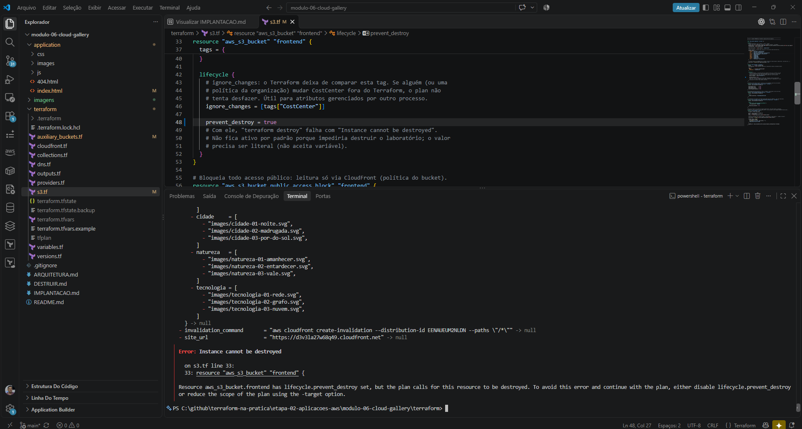

*Figura 21 — Bloqueio do destroy causado por prevent_destroy.*

---

## 9. Mapa de arquivos

| Arquivo | Conteúdo |
|---|---|
| `versions.tf`, `providers.tf` | Versões; provider padrão e provider `us_east_1` |
| `variables.tf` | Entradas com validações (`auxiliary_buckets`, `error_pages` e outras) |
| `s3.tf` | Bucket do frontend e upload |
| `auxiliary_buckets.tf` | `for_each`, `count`, condicionais, `precondition` |
| `collections.tf` | Tipos de coleção e expressões `for` (sem recursos) |
| `cloudfront.tf` | OAC, distribuição, policy |
| `dns.tf` | Route 53 e ACM (opcional) |
| `outputs.tf` | Nome do bucket, buckets auxiliares, distribuição, URLs, contagem por categoria e tipos de coleção |
