# Implantação - Terraform na Prática: coleções do Terraform com count, for_each e expressões for

Todos os recursos são criados pelo Terraform. Não use o console da AWS para criar nada deste laboratório. Comandos para PowerShell.

Nenhum comando de `apply` ou `destroy` é executado por scripts.

## 1. Pré-requisitos

```powershell
terraform version
aws sso login --profile <seu-perfil>
$env:AWS_PROFILE = "<seu-perfil>"
aws sts get-caller-identity       # confirme a conta ANTES de aplicar
```

Permissões necessárias: S3, CloudFront (distribuição e OAC) e, se usar domínio, Route 53 (`ListHostedZones`, `ChangeResourceRecordSets`) e `acm:ListCertificates`.

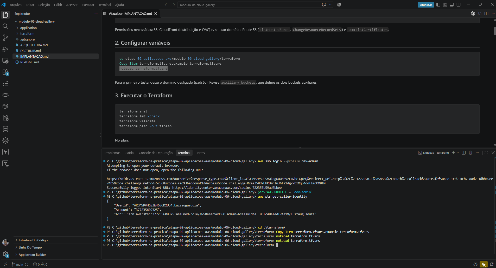

*Figura 1 — Login com AWS SSO e validação da identidade com sts get-caller-identity.*

## 2. Configurar variáveis

```powershell
cd etapa-02-aplicacoes-aws/modulo-06-cloud-gallery/terraform
Copy-Item terraform.tfvars.example terraform.tfvars
notepad terraform.tfvars
```

Para o primeiro teste, deixe o domínio desligado (padrão). Revise `auxiliary_buckets`, que define os dois buckets auxiliares.

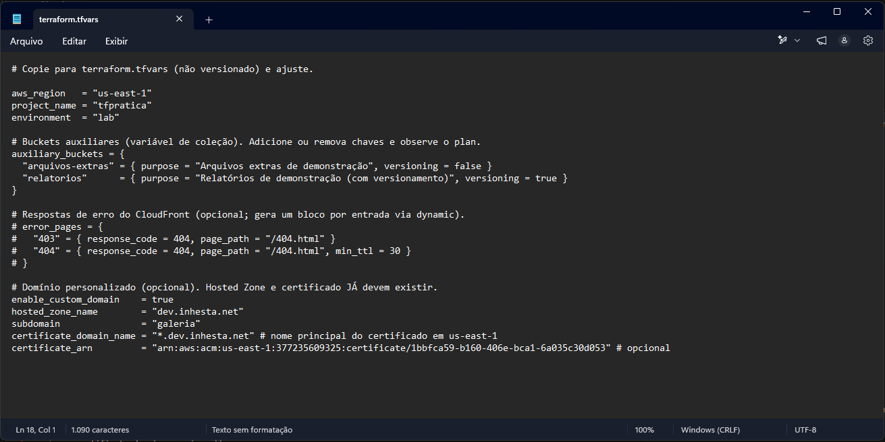

*Figura 2 — Arquivo terraform.tfvars com as variáveis do domínio personalizado.*

## 3. Executar o Terraform

```powershell
terraform init
terraform fmt -check
terraform validate
terraform plan -out tfplan
```

No plan:

- `Plan: 30 to add, 0 to change, 0 to destroy.` (domínio desligado).
- `aws_s3_bucket_policy.frontend` com `policy = (known after apply)`.
- `aws_cloudfront_distribution.site` com `domain_name`, `arn` e `id` `(known after apply)`.
- Procure `aws_s3_bucket.auxiliary["arquivos-extras"]` e `["relatorios"]`.

Aplicar:

```powershell
terraform apply tfplan
```

A distribuição leva alguns minutos para ficar `Deployed`. A policy só é criada depois dela.

```powershell
terraform output
```

Outputs: `frontend_bucket_name`, `auxiliary_buckets`, `cloudfront_distribution_id`, `cloudfront_domain_name`, `site_url`, `custom_url`, `invalidation_command`, `category_counts`, `images_by_category` e `collection_types_demo`.

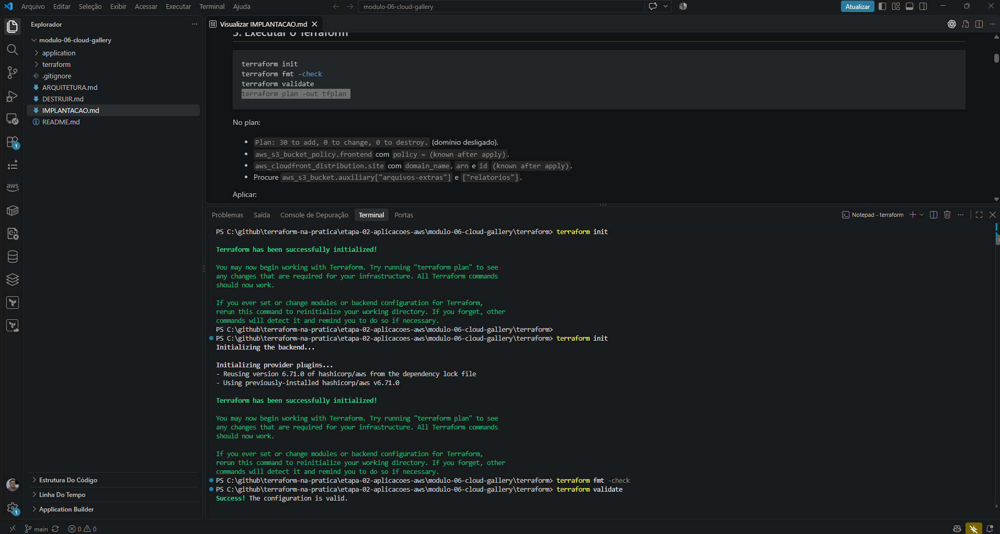

*Figura 3 — Resultado de terraform init, fmt e validate.*

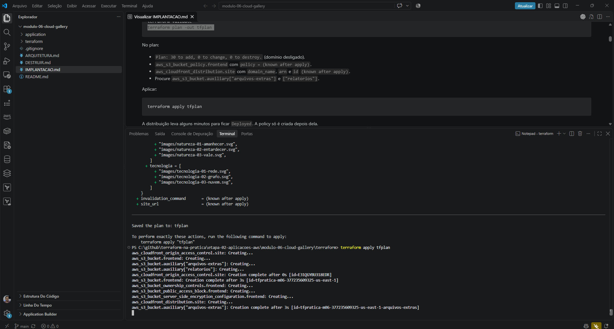

*Figura 4 — Plano salvo (tfplan) e aplicação com terraform apply.*

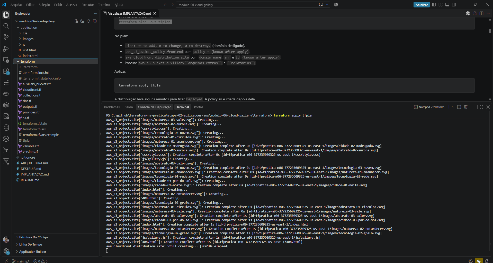

*Figura 5 — Objetos do frontend e das imagens enviados ao S3 durante o apply.*

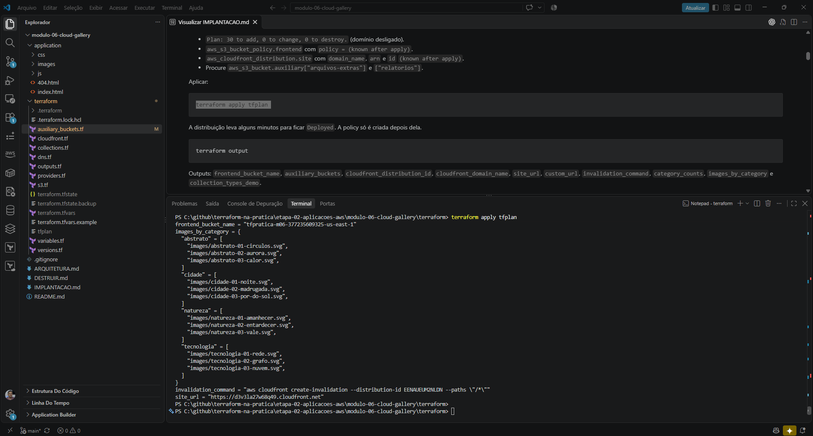

*Figura 6 — Outputs com o domínio personalizado desligado.*

## 4. Verificar a galeria

### 4.1 HTTPS e redirecionamento

```powershell
$site = terraform output -raw site_url
curl.exe -I $site                                              # HTTP/2 200, content-type text/html
curl.exe -I ($site -replace "^https","http")                   # 301 com location: https://...
```

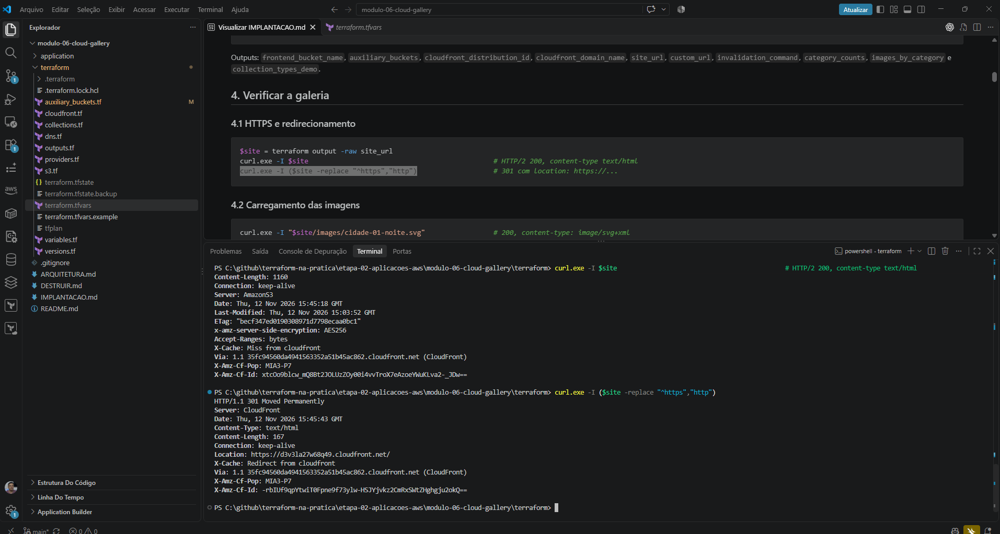

*Figura 7 — curl confirmando HTTPS e o redirecionamento de HTTP para HTTPS.*

### 4.2 Carregamento das imagens

```powershell
curl.exe -I "$site/images/cidade-01-noite.svg"                 # 200, content-type: image/svg+xml
curl.exe -I "$site/inexistente.png"                            # 404 (a página 404.html)
Start-Process $site
```

No navegador, abra as ferramentas do desenvolvedor (F12), aba *Network*, e confirme que as 12 imagens, o CSS e o JS retornam `200`.

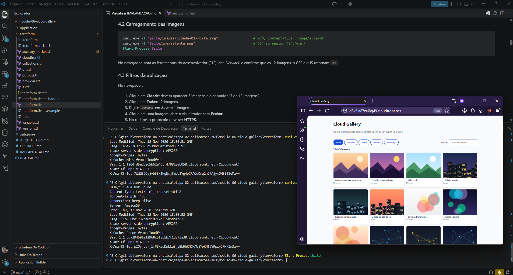

*Figura 8 — curl nas imagens e no caminho inexistente, com o resultado no navegador.*


*Figura 9 — Galeria publicada acessada pela URL do CloudFront.*

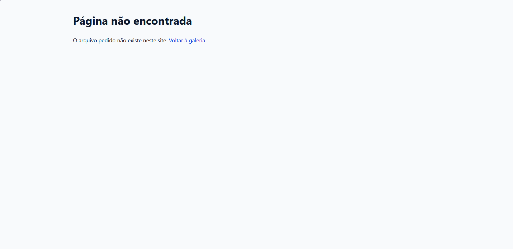

*Figura 10 — Página de erro 404 servida pelo CloudFront.*

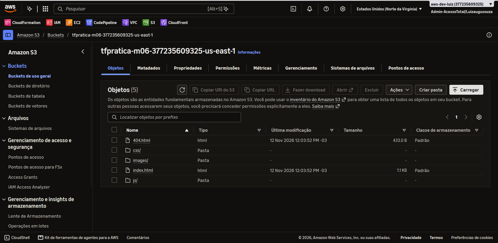

*Figura 11 — Objetos do frontend no bucket S3.*

### 4.3 Filtros da aplicação

No navegador:

1. Clique em **Cidade**: devem aparecer 3 imagens e o contador "3 de 12 imagens".
2. Clique em **Todas**: 12 imagens.
3. Digite `aurora` em *Buscar*: 1 imagem.
4. Clique em uma imagem: abre o visualizador com **Fechar**.
5. No rodapé, o protocolo deve ser **HTTPS**.

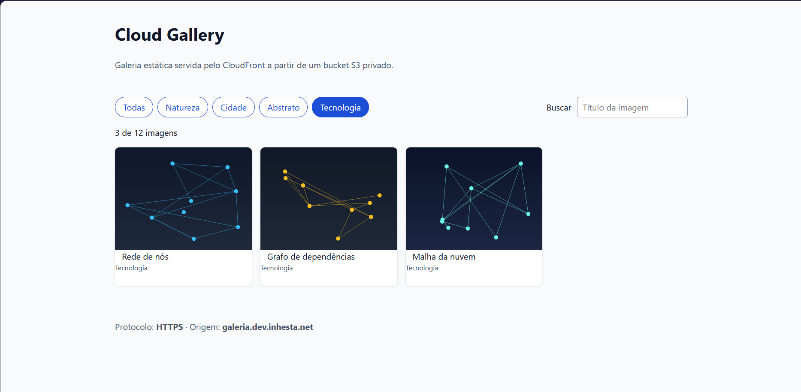

*Figura 12 — Filtro por tecnologia na galeria.*

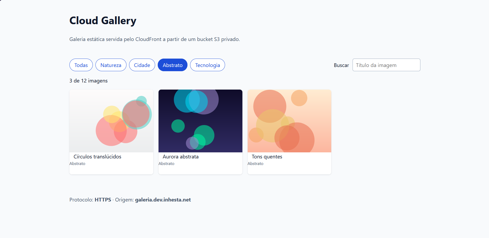

*Figura 13 — Filtro por categoria abstrato na galeria.*

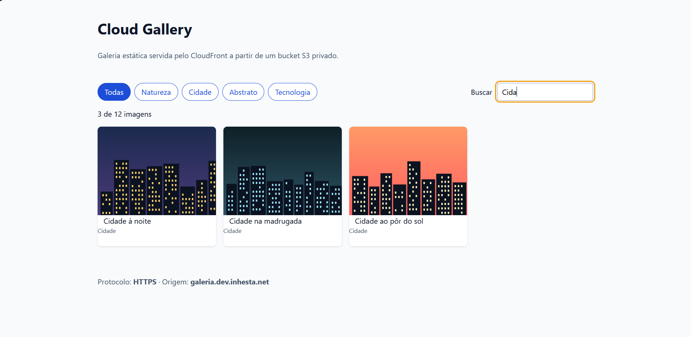

*Figura 14 — Busca por nome na galeria.*

### 4.4 Permissões do bucket

```powershell
$bucket = terraform output -raw frontend_bucket_name
aws s3api get-public-access-block --bucket $bucket
aws s3api get-bucket-policy --bucket $bucket --query Policy --output text
curl.exe -I "https://$bucket.s3.us-east-1.amazonaws.com/index.html"   # 403: bucket privado
```

Confirme que a policy tem `Principal.Service = cloudfront.amazonaws.com` e a condição `AWS:SourceArn` com o ARN da sua distribuição. Ajuste a região na URL se mudou `aws_region`.

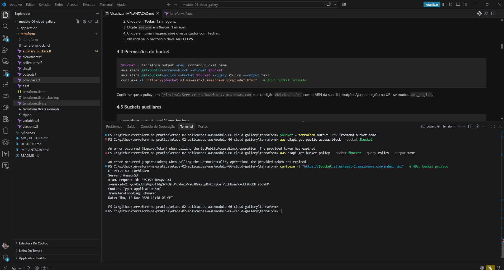

*Figura 15 — Acesso direto ao bucket retorna 403: o bucket é privado.*

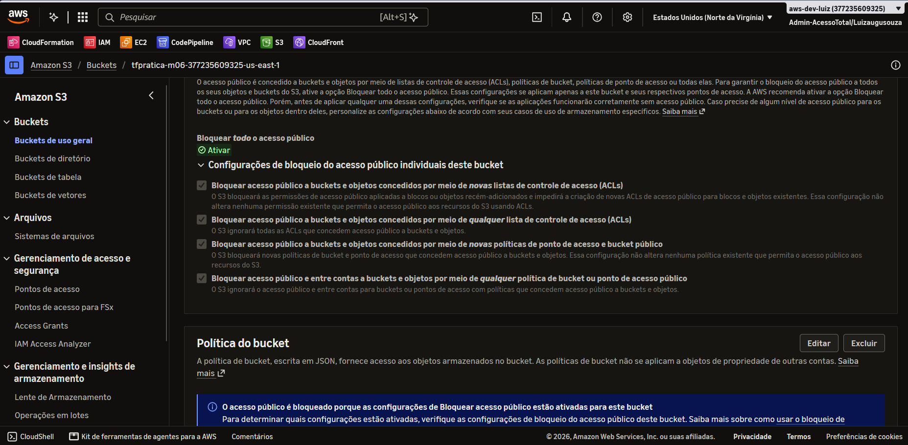

*Figura 16 — Bloqueio de acesso público habilitado no bucket do frontend.*

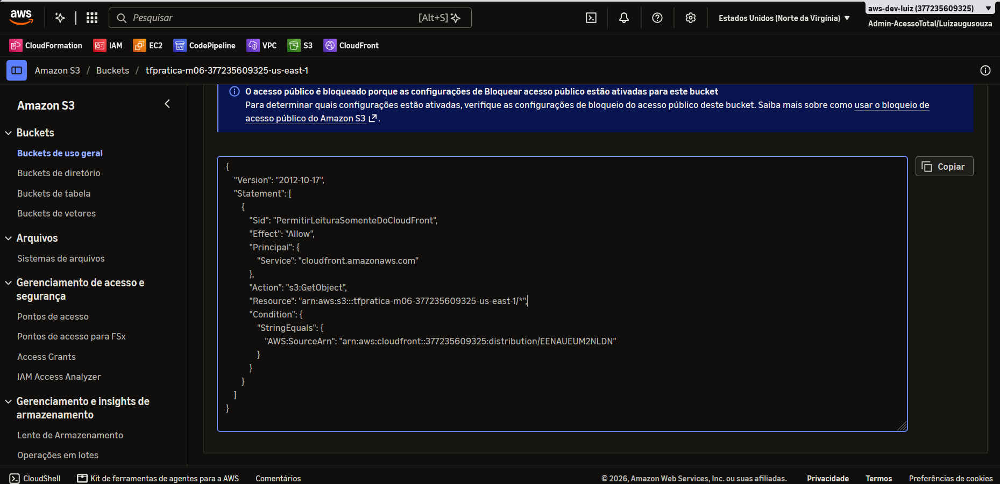

*Figura 17 — Bucket policy permitindo a leitura somente pelo CloudFront (OAC).*

### 4.5 Buckets auxiliares

```powershell
terraform output auxiliary_buckets
$aux = terraform output -json auxiliary_buckets | ConvertFrom-Json
aws s3api get-bucket-versioning --bucket $aux.relatorios.name              # Status: Enabled
aws s3api get-bucket-versioning --bucket $aux.'arquivos-extras'.name   # sem Status
terraform state list | Select-String "auxiliary"
```

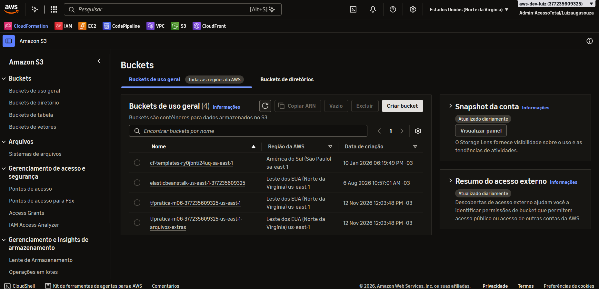

*Figura 18 — Lista de buckets S3 com o bucket do frontend e os buckets auxiliares.*

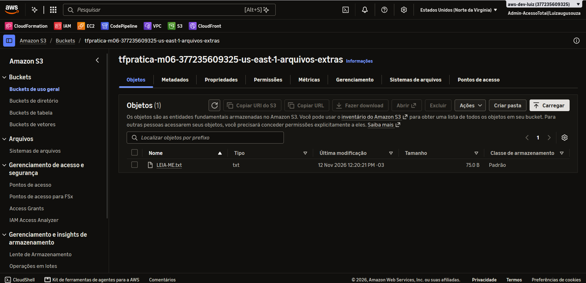

*Figura 19 — Bucket auxiliar de arquivos extras no console do S3.*

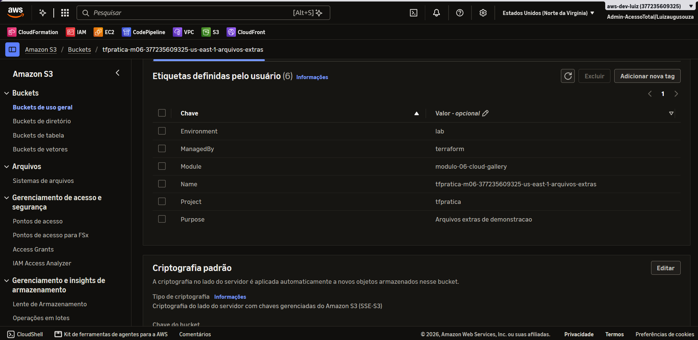

*Figura 20 — Tags do bucket auxiliar geradas a partir da coleção.*

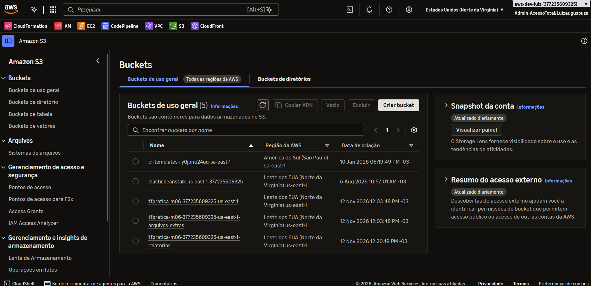

*Figura 21 — Lista completa de buckets S3 antes de testar o prevent_destroy.*

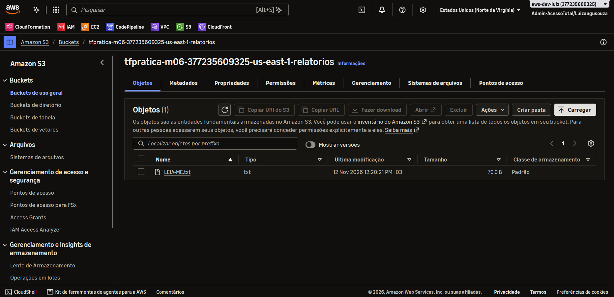

*Figura 22 — Objetos do bucket de relatórios no console do S3.*

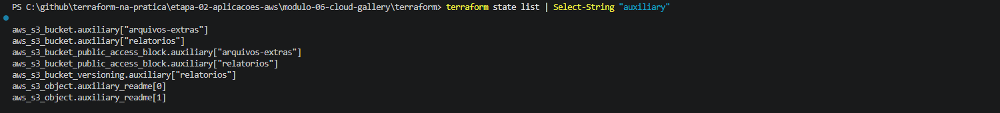

*Figura 23 — terraform state list mostrando os endereços dos buckets auxiliares.*

## 5. Experimentos de Terraform

Cada experimento diz **para que serve**, **onde executar** e **o que esperar**. Faça-os em ordem, dentro da pasta `terraform` do módulo. Nenhum deles exige `apply`, exceto onde indicado. Antes de alterar o `terraform.tfvars`, guarde uma cópia para voltar ao estado original.

### 5.1 Inspecionar os tipos de coleção e as expressões for

**Para que serve:** ver, sem criar nada, o que `toset`, `tomap` e `for` produzem.

```powershell
terraform console
```

No prompt `>`, digite uma expressão por vez:

```
> local.example_list
> local.example_set
> local.example_tuple
> local.images_by_category
> local.category_counts
> local.city_images
> local.auxiliary_keys
```

Esperado: `example_set` sem o `"a"` repetido; `category_counts` com 3 imagens em cada uma das 4 categorias; `images_by_category` com listas de arquivos. Saia com `exit`.

Depois do `apply`, os mesmos resultados saem como outputs:

```powershell
terraform output category_counts
terraform output collection_types_demo
```

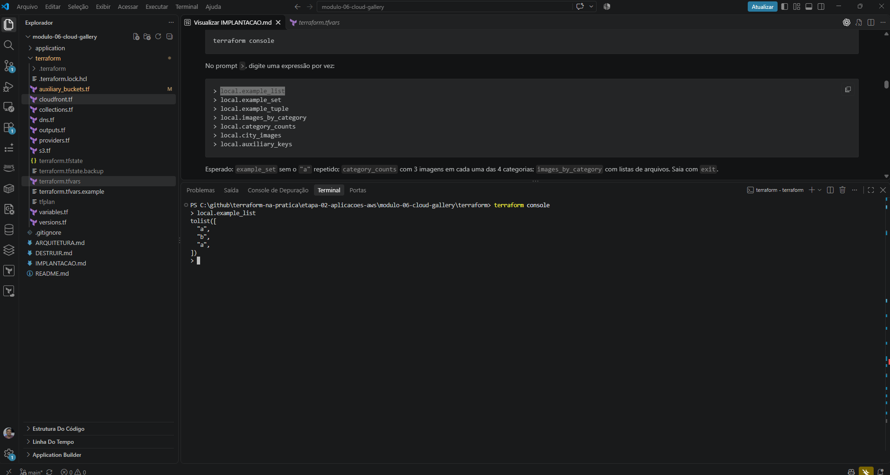

*Figura 24 — Lista e conjunto (set) avaliados no terraform console.*

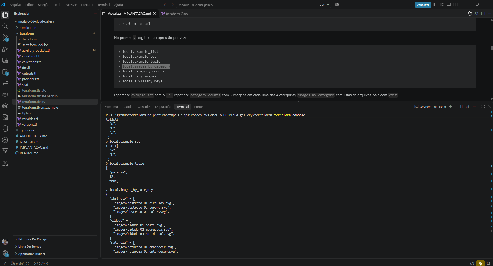

*Figura 25 — Tupla e categorias avaliadas no terraform console.*

### 5.2 Por que for_each não aceita lista

**Para que serve:** entender a mensagem de erro mais comum com `for_each`.

Crie o arquivo temporário `zz_teste.tf`:

```hcl
resource "terraform_data" "x" {
  for_each = local.example_list
}
```

```powershell
terraform validate
```

Esperado: `Invalid for_each argument ... must be a map, or set of strings`. Corrija trocando por `toset(local.example_list)` e rode `terraform validate` de novo: passa. **Apague o arquivo `zz_teste.tf` ao terminar.**

### 5.3 Adicionar uma chave

**Para que serve:** ver a diferença de identidade entre `for_each` e `count`.

Em `terraform.tfvars`:

```hcl
auxiliary_buckets = {
  "arquivos-extras" = { purpose = "Arquivos extras de demonstração", versioning = false }
  "relatorios"      = { purpose = "Relatórios de demonstração (com versionamento)", versioning = true }
  "backup"          = { purpose = "Backup de demonstração", versioning = true }
}
```

```powershell
terraform plan
```

O que ler no plan:

- `for_each`: aparecem `+` para `aws_s3_bucket.auxiliary["backup"]`, seu bloqueio público e seu versionamento. Os buckets existentes não mudam.
- `count`: aparece um novo `aws_s3_object.auxiliary_readme[...]`, e os índices dos existentes podem se deslocar porque a lista de chaves é ordenada (`backup` vem antes de `relatorios`).

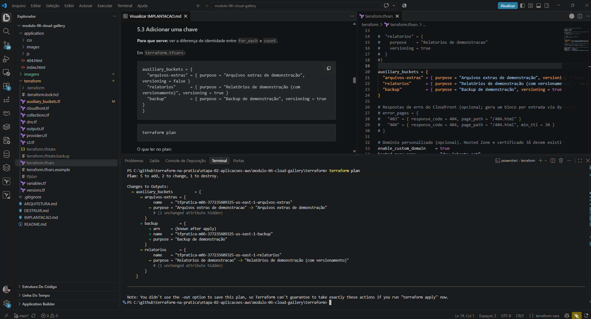

*Figura 26 — Plan ao adicionar uma chave no for_each: apenas um recurso novo.*

### 5.4 Remover uma chave e comparar

**Para que serve:** ver o deslocamento de índice do `count`.

Volte ao mapa original e **remova** `"arquivos-extras"`:

```powershell
terraform plan
```

- `for_each`: só `aws_s3_bucket.auxiliary["arquivos-extras"]` (e seus filhos) tem `-`. `relatorios` não é tocado.
- `count`: `relatorios` passa de `[1]` para `[0]`. O plan mostra alteração ou recriação do objeto `LEIA-ME.txt` por causa do deslocamento, não apenas "remover o item que saiu".

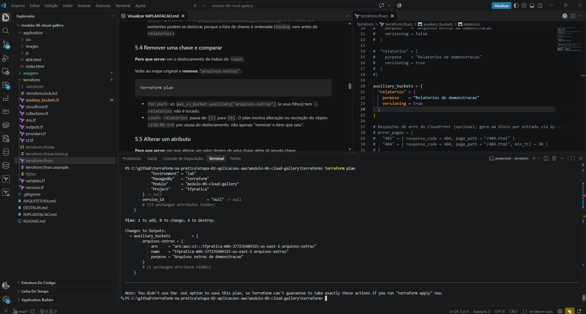

*Figura 27 — Plan ao remover uma chave do for_each: apenas um recurso removido.*

### 5.5 Alterar um atributo

**Para que serve:** ver que alterar um valor dentro de uma chave afeta só aquela chave.

Restaure o mapa e mude `versioning` de `relatorios` para `false`:

```powershell
terraform plan
```

Esperado: `- aws_s3_bucket_versioning.auxiliary["relatorios"]`, porque o filtro `if v.versioning` deixou de incluir essa chave. Nenhum bucket é recriado.

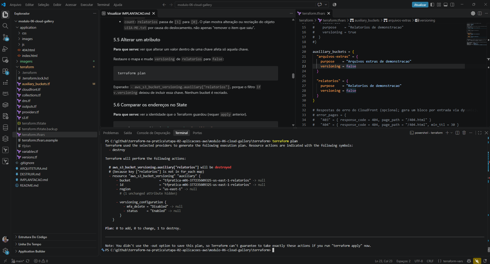

*Figura 28 — Plan ao alterar um atributo: atualização em lugar, sem recriar.*

### 5.6 Comparar os endereços no State

**Para que serve:** ver a identidade que o Terraform guardou (requer `apply` anterior).

```powershell
terraform state list | Select-String "auxiliary"
```

Esperado: endereços com **chave** para buckets (`aws_s3_bucket.auxiliary["relatorios"]`) e com **índice** para os arquivos (`aws_s3_object.auxiliary_readme[0]`).

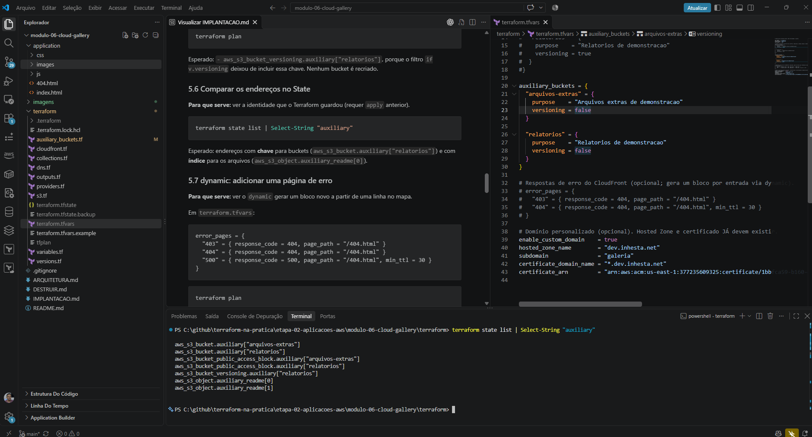

*Figura 29 — terraform state list: endereços identificados por chave.*

### 5.7 dynamic: adicionar uma página de erro

**Para que serve:** ver o `dynamic` gerar um bloco novo a partir de uma linha no mapa.

Em `terraform.tfvars`:

```hcl
error_pages = {
  "403" = { response_code = 404, page_path = "/404.html" }
  "404" = { response_code = 404, page_path = "/404.html" }
  "500" = { response_code = 500, page_path = "/404.html", min_ttl = 30 }
}
```

```powershell
terraform plan
```

Esperado: `~ aws_cloudfront_distribution.site` com um novo bloco `custom_error_response` para o código 500. Nada é recriado. Remova a entrada para voltar ao padrão.

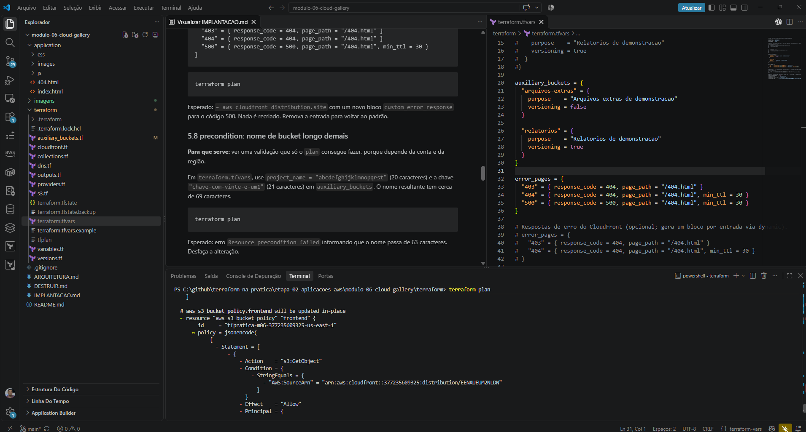

*Figura 30 — Plan do bloco dynamic adicionando uma página de erro.*

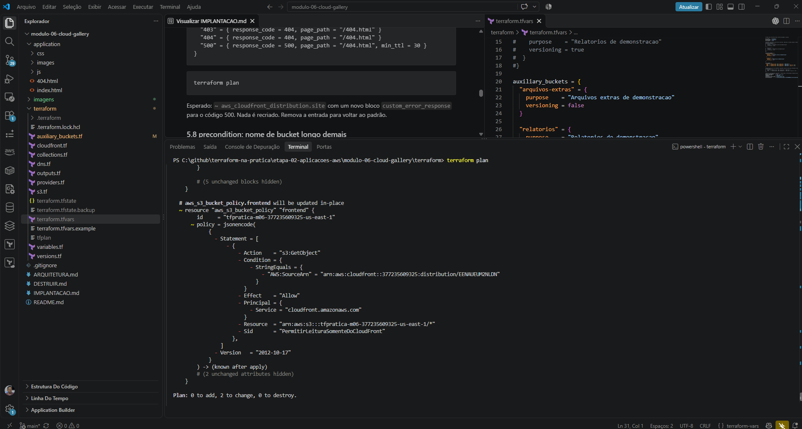

*Figura 31 — Resumo do plan com as páginas de erro geradas pelo dynamic.*

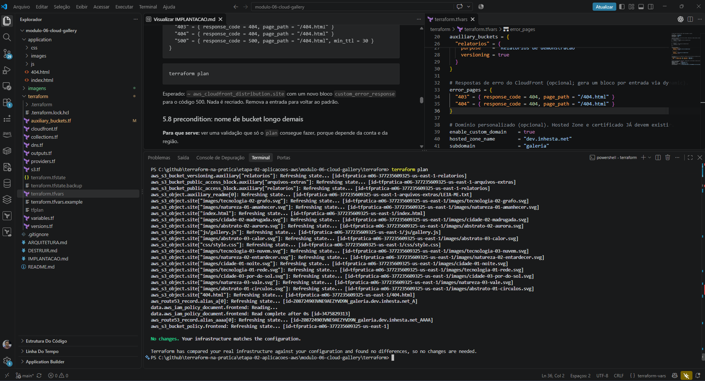

*Figura 32 — Plan sem mudanças após retornar à configuração original.*

### 5.8 precondition: nome de bucket longo demais

**Para que serve:** ver uma validação que só o `plan` consegue fazer, porque depende da conta e da região.

Em `terraform.tfvars`, use `project_name = "abcdefghijklmnopqrst"` (20 caracteres) e a chave `"chave-com-vinte-e-um1"` (21 caracteres) em `auxiliary_buckets`. O nome resultante tem cerca de 69 caracteres.

```powershell
terraform plan
```

Esperado: erro `Resource precondition failed` informando que o nome passa de 63 caracteres. Desfaça a alteração.
### 5.9 Atualização de conteúdo e cache

1. Edite o título em `application/index.html`.
2. `terraform plan`: deve mostrar `~ aws_s3_object.site["index.html"]` com `source_hash` alterado e **1 to change**.
3. `terraform apply`.
4. Abra o site: pode continuar mostrando a versão antiga (cache do CloudFront).
5. Invalide:

```powershell
aws cloudfront create-invalidation --distribution-id $(terraform output -raw cloudfront_distribution_id) --paths "/index.html"
aws cloudfront list-invalidations --distribution-id $(terraform output -raw cloudfront_distribution_id)
```

Quando o status for `Completed`, recarregue (Ctrl+F5).

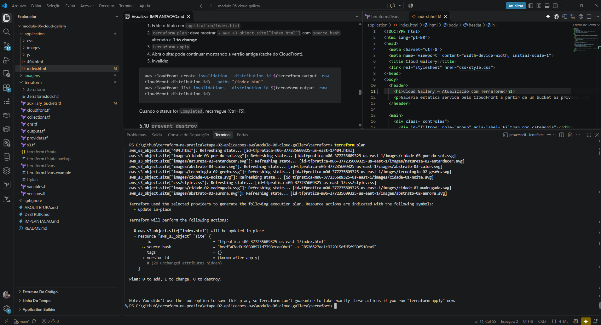

*Figura 33 — Plan atualizando o index.html (mudança de conteúdo).*

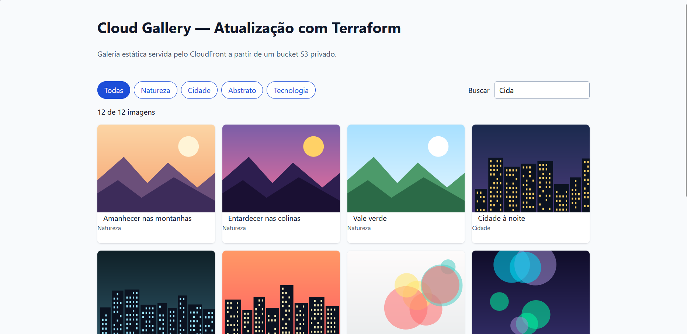

*Figura 34 — Galeria exibindo o conteúdo atualizado.*

### 5.10 `prevent_destroy`

Em `s3.tf`, dentro do bloco `lifecycle` do bucket do frontend, remova **somente o `# ` do início** da linha `# prevent_destroy = true` (a linha de comentário acima dela deve continuar comentada). Se apagar mais do que isso, o Terraform acusa erro de sintaxe, como na figura 35. Depois rode:

```powershell
terraform plan -destroy
```

Leia o erro `Instance cannot be destroyed`. **Volte a comentar a linha (`# prevent_destroy = true`)** antes de destruir o laboratório.

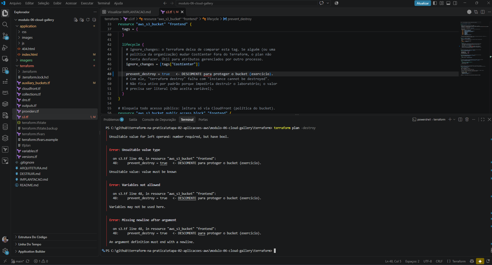

*Figura 35 — Erro de sintaxe ao descomentar o prevent_destroy de forma incorreta.*

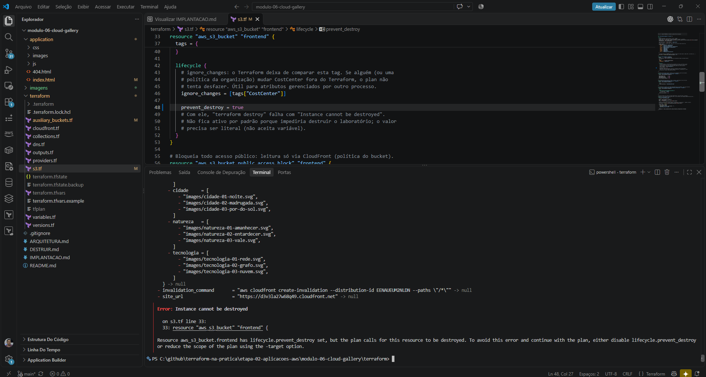

*Figura 36 — Bloqueio do destroy causado por prevent_destroy.*

### 5.11 `ignore_changes`

Em `s3.tf`, mude o valor da tag no código, de `CostCenter = "laboratorio"` para `CostCenter = "outro"`, e rode:

```powershell
terraform plan
```

O plan responde `No changes`: a tag `CostCenter` está em `ignore_changes`, então o Terraform não compara esse valor. Troque outra tag (por exemplo `Name`) e o plan mostrará `~ update in-place`. Desfaça a edição ao terminar.

## 6. Domínio personalizado (opcional)

Pré-requisito: você já tem a Hosted Zone pública e um certificado ACM **emitido em us-east-1** que cobre o nome.

### 6.1 Levantar os dados existentes

```powershell
aws route53 list-hosted-zones-by-name --dns-name exemplo.com.br `
  --query "HostedZones[].[Name,Id,Config.PrivateZone]"

aws acm list-certificates --region us-east-1 --certificate-statuses ISSUED `
  --query "CertificateSummaryList[].[DomainName,CertificateArn]" --output table
```

### 6.2 Conferir se o nome está livre

```powershell
aws route53 list-resource-record-sets --hosted-zone-id <zona> `
  --query "ResourceRecordSets[?Name=='galeria.exemplo.com.br.']"
aws cloudfront list-distributions --query "DistributionList.Items[].Aliases.Items"
```

As duas consultas devem vir vazias para o seu subdomínio. Se existir registro, escolha outro `subdomain`: o módulo nunca sobrescreve (`allow_overwrite = false`).

### 6.3 Habilitar

```hcl
enable_custom_domain    = true
hosted_zone_name        = "exemplo.com.br"
subdomain               = "galeria"
certificate_domain_name = "*.exemplo.com.br"   # nome principal do certificado
# certificate_arn       = "arn:aws:acm:us-east-1:...:certificate/..."   # opcional
```

```powershell
terraform plan
```

Esperado: `~ aws_cloudfront_distribution.site` (aliases e certificado) e `+ aws_route53_record.alias_a[0]` e `alias_aaaa[0]`. Nenhuma Hosted Zone nem certificado nos recursos a criar.

Possíveis erros das `precondition`:

- *"O certificado do CloudFront precisa estar em us-east-1"*: use um certificado da região correta.
- *"não cobre galeria.exemplo.com.br"*: informe o nome ou curinga corretos.

```powershell
terraform apply
Resolve-DnsName galeria.exemplo.com.br
curl.exe -I $(terraform output -raw custom_url)
```

A propagação do DNS e da distribuição pode levar alguns minutos. O `site_url` do CloudFront continua válido.

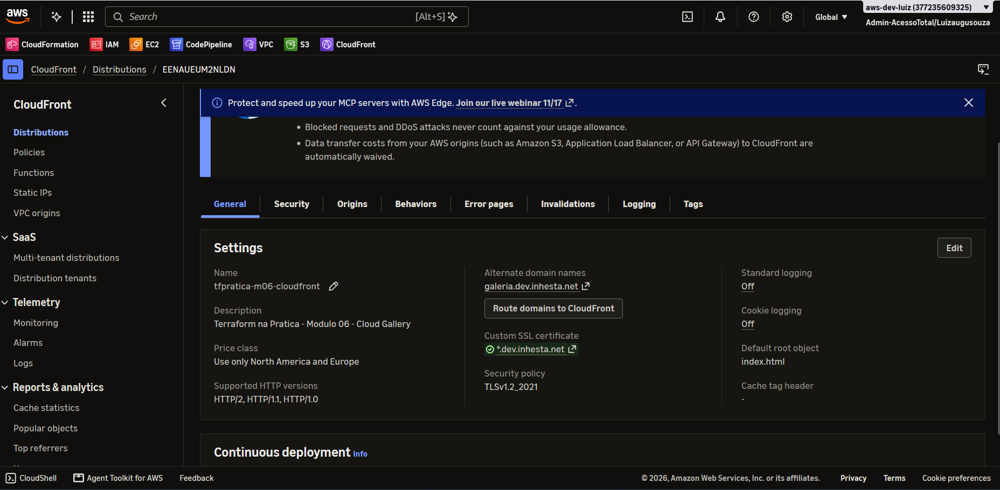

*Figura 37 — Distribuição do CloudFront no console da AWS.*

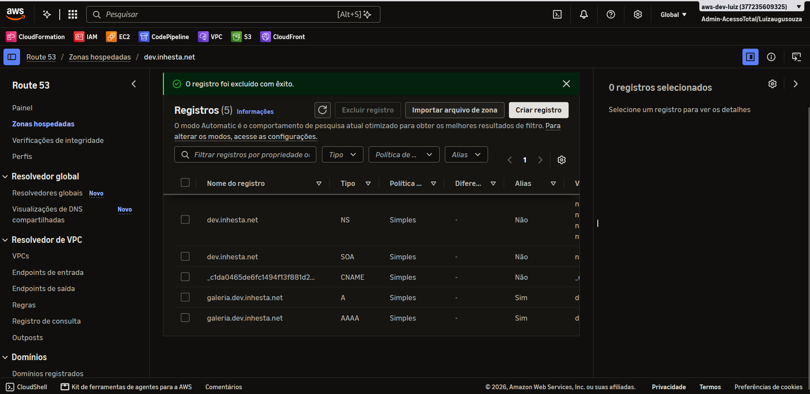

*Figura 38 — Registros do Route 53 criados pelo Terraform.*

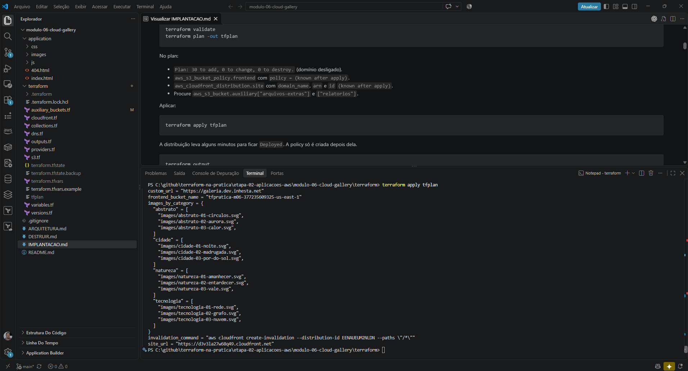

*Figura 39 — Outputs com o domínio personalizado ligado.*

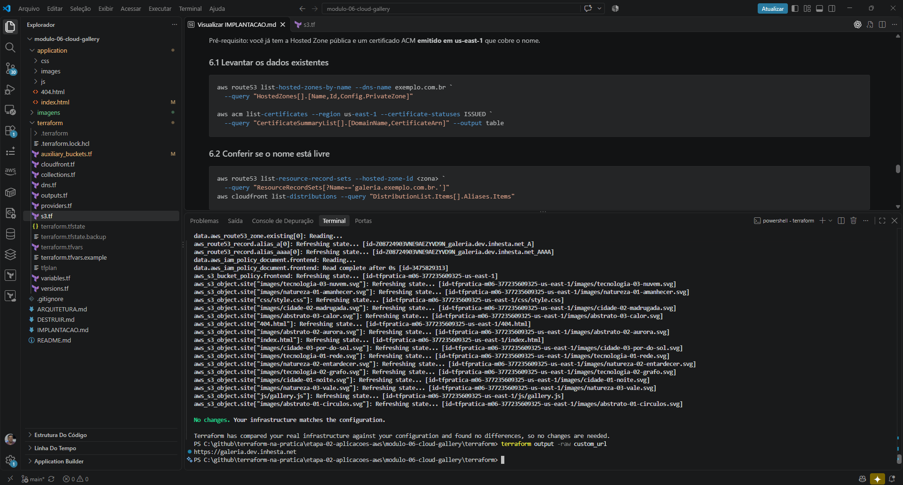

*Figura 40 — Plan com o domínio personalizado sem mudanças.*

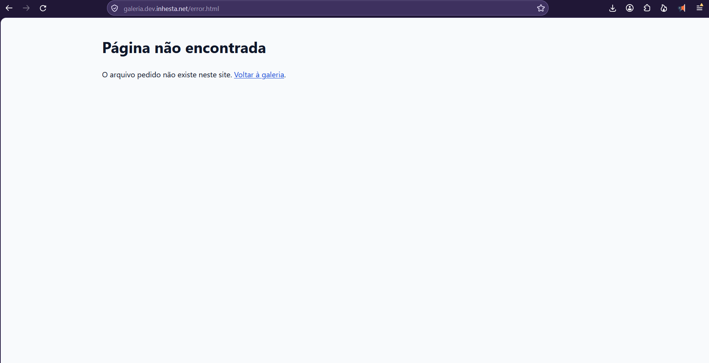

*Figura 41 — Página de erro 404 servida pelo domínio personalizado.*

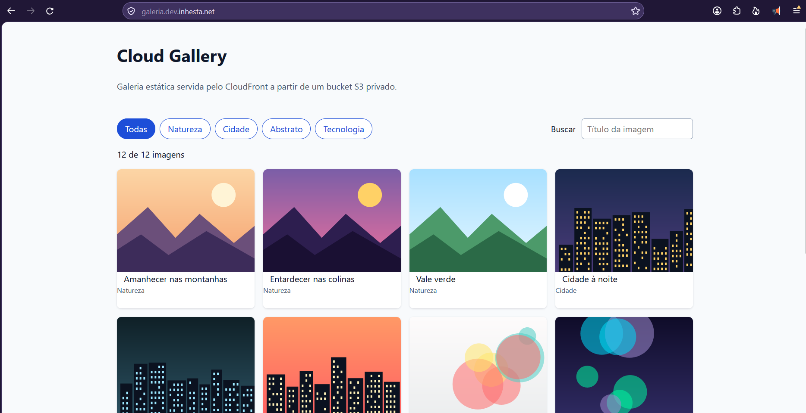

*Figura 42 — Galeria acessada pelo domínio personalizado.*

## 7. Problemas comuns

| Sintoma | Causa | Ação |
|---|---|---|
| `403` ao abrir o site | Policy ainda não criada ou sem arquivo `index.html` | Aguarde o apply concluir e confira `terraform state list` |
| Site antigo após `apply` | Cache do CloudFront | Crie a invalidação |
| `BucketAlreadyExists` | Nome já usado | Mude `project_name` |
| `OperationAborted` na policy | Alterações simultâneas no bucket | Rode `terraform apply` de novo |
| `CNAMEAlreadyExists` | Alias já em outra distribuição | Use outro `subdomain` |
| `InvalidViewerCertificate` | Certificado fora de us-east-1 ou sem cobertura | Revise a seção 6 |
| Imagens sem renderizar | Content-Type incorreto | Confira `head-object`; revise `local.content_types` |

Para encerrar, siga o [DESTRUIR.md](DESTRUIR.md).
