# Terraform na Prática: coleções do Terraform com count, for_each e expressões for


*Figura 1 — Capa do Módulo 06: coleções do Terraform com count, for_each e expressões for.*

## Gerenciamento de coleções com Terraform

Em infraestrutura real quase nada é único: vários buckets, vários arquivos, várias regras. Escrever um bloco `resource` para cada item não escala e é fácil de errar. Este módulo mostra como o Terraform **multiplica** recursos a partir de coleções e, principalmente, **como ele identifica cada cópia**, porque é essa identidade que decide o que o `plan` vai criar, alterar ou destruir.

A aplicação é uma galeria de imagens com filtros e busca, publicada por HTTPS em um bucket S3 privado atrás do CloudFront. Ela é o pano de fundo. O estudo está nos arquivos `.tf`.

## O que já sabemos e o que é novo

| Reutilizado | Origem |
|---|---|
| S3 privado, CloudFront, OAC, policy por `SourceArn` | Módulos 02 a 04 |
| `variable`, `validation`, `locals`, `merge` | Módulo 03 |
| `count` para criação condicional, `toset()` em data sources, `for`, `precondition`, `lifecycle` | Módulo 05 |

| Aprofundado neste módulo | Onde |
|---|---|
| Tipos `list`, `set`, `map`, `object`, `tuple` | `collections.tf` |
| `count` e `count.index` (identidade por posição) | `aws_s3_object.auxiliary_readme` |
| `for_each` sobre mapa, conjunto e outro recurso (identidade por chave) | `auxiliary_buckets.tf`, `s3.tf` |
| `map(object({...}))` e `optional()` | `variable "auxiliary_buckets"`, `variable "error_pages"` |
| Expressões `for`: filtro, conversão e agrupamento (`...`) | `collections.tf` |
| Bloco `dynamic` com coleção | `custom_error_response` em `cloudfront.tf` |
| `lifecycle`: `ignore_changes`, `prevent_destroy`, `create_before_destroy`, `precondition` | `s3.tf`, `auxiliary_buckets.tf` |

## Os tipos de coleção

| Tipo | Ordem | Repetição | Acesso | Exemplo |
|---|---|---|---|---|
| `list` | sim | permite | índice `[0]` | `tolist(["a", "b", "a"])` |
| `set` | não | não permite | não indexável | `toset(["a", "b", "a"])` resulta em `["a", "b"]` |
| `map` | por chave | chaves únicas | chave `["lab"]` | `tomap({ lab = "experimental" })` |
| `object` | atributos fixos | n/a | `.atributo` | `{ name = "galeria", images = 12 }` |
| `tuple` | sim | permite | índice | `["galeria", 12, true]` (tipos mistos) |

Um literal `["a", "b"]` no código é uma **tuple**. `tolist()` e `toset()` fixam o tipo. A diferença importa porque `for_each` só aceita `map` ou `set` de textos. Uma lista é recusada com o erro `Invalid for_each argument`.

`map(object({...}))` combina os dois mundos: um mapa em que cada valor é um registro tipado.

```hcl
variable "auxiliary_buckets" {
  type = map(object({
    purpose    = string
    versioning = bool
  }))
}
```

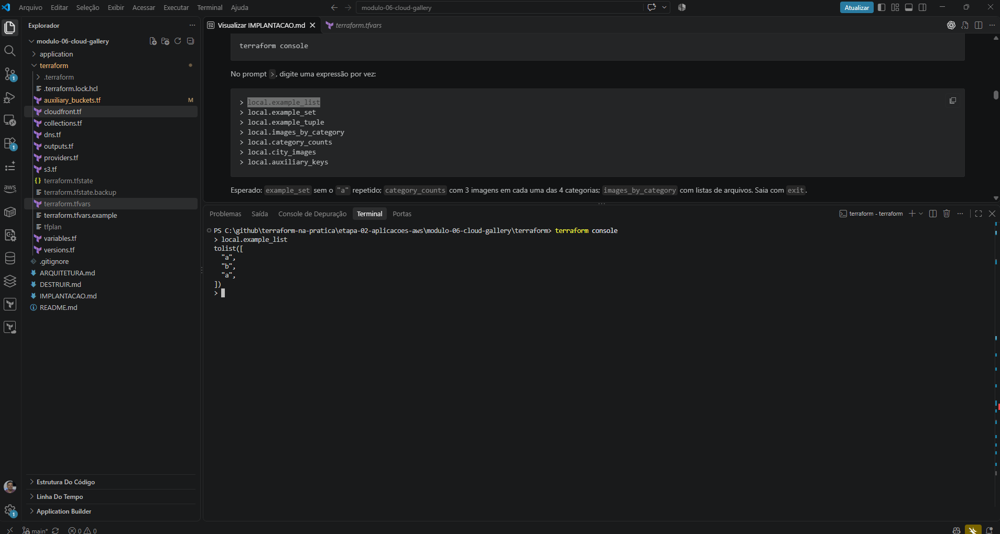

*Figura 2 — Lista e conjunto (set) avaliados no terraform console.*

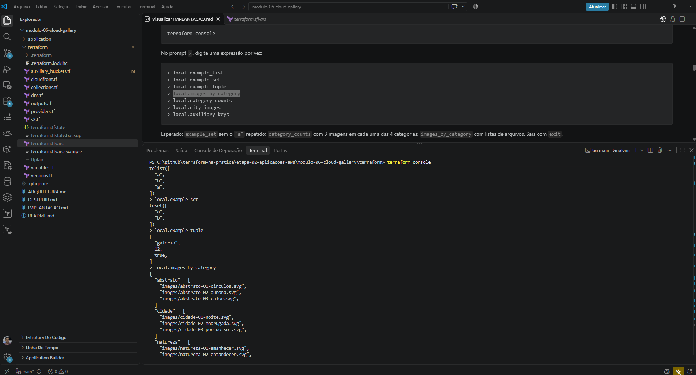

*Figura 3 — Tupla e categorias avaliadas no terraform console.*

## count: identidade por posição

```hcl
resource "aws_s3_object" "auxiliary_readme" {
  count = length(local.auxiliary_keys)
  bucket = aws_s3_bucket.auxiliary[local.auxiliary_keys[count.index]].id
  # ...
}
```

O Terraform dá a cada cópia um número: `aws_s3_object.auxiliary_readme[0]`, `[1]`. `count.index` vale 0, 1, 2... dentro do bloco. Se a lista mudar de tamanho ou de ordem, **o número muda de dono**: remover o primeiro item faz o segundo virar `[0]`. Para o Terraform, o `[0]` antigo e o novo são o mesmo endereço com argumentos diferentes, e ele propõe alterar ou recriar.

## for_each: identidade por chave

```hcl
resource "aws_s3_bucket" "auxiliary" {
  for_each = var.auxiliary_buckets

  bucket = "${local.bucket_prefix}-${each.key}"
  tags   = { Purpose = each.value.purpose }
}
```

- `each.key` é a chave do mapa (`"relatorios"`).
- `each.value` é o valor associado (o objeto `{ purpose, versioning }`).
- O endereço no State é `aws_s3_bucket.auxiliary["relatorios"]`. A identidade é a chave, não a posição.

Em um conjunto (`set`), `each.key` e `each.value` são iguais. É o caso de `aws_s3_object.site`, que itera sobre `fileset()`: o endereço é o próprio caminho do arquivo, `aws_s3_object.site["index.html"]`.

O módulo ainda mostra `for_each` sobre **outro recurso** (`aws_s3_bucket_public_access_block.auxiliary` itera sobre `aws_s3_bucket.auxiliary`) e sobre um mapa **filtrado** (`aws_s3_bucket_versioning.auxiliary`, só os buckets com `versioning = true`).

## count x for_each: o que o plan faz

Com os dois buckets padrão, `arquivos-extras` e `relatorios`:

| Alteração no mapa | for_each (buckets) | count (LEIA-ME) |
|---|---|---|
| Adicionar `"backup"` | cria somente `auxiliary["backup"]` e seus filhos | cria um novo índice; os existentes podem se deslocar, pois a lista é ordenada |
| Remover `"arquivos-extras"` | destrói somente `auxiliary["arquivos-extras"]` | `relatorios` passa de `[1]` para `[0]`: o plan mostra alteração/recriação por deslocamento |
| Mudar `versioning` de `relatorios` para `false` | destrói somente `aws_s3_bucket_versioning.auxiliary["relatorios"]` | sem mudança |
| Renomear a chave `"relatorios"` para `"logs"` | destrói o bucket antigo e cria o novo (a chave é a identidade) | idem, por posição |

Regra prática: use `count` para ligar e desligar um recurso (`count = var.x ? 1 : 0`) ou quando a ordem é a identidade. Use `for_each` quando os itens têm nome próprio e a coleção pode mudar.

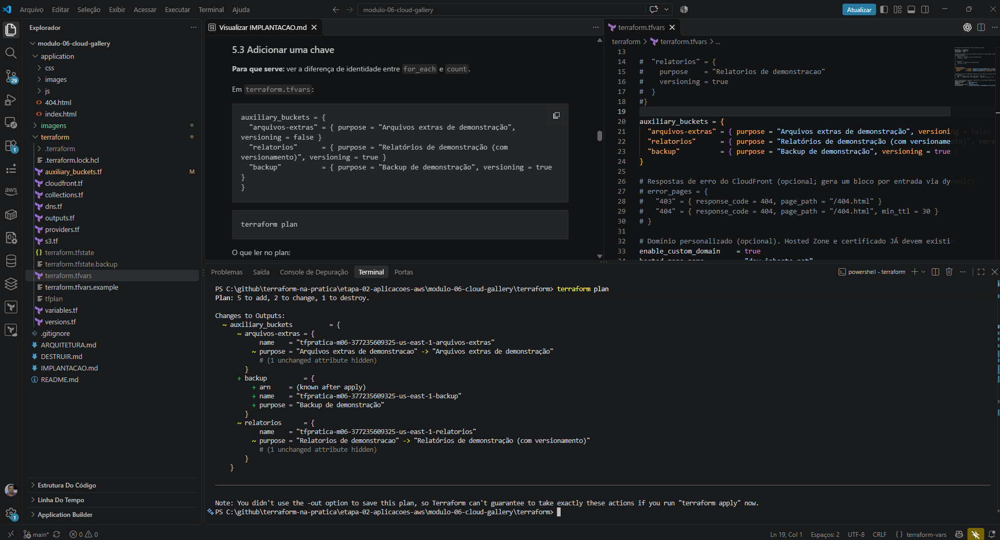

*Figura 4 — Plan ao adicionar uma chave no for_each: apenas um recurso novo.*

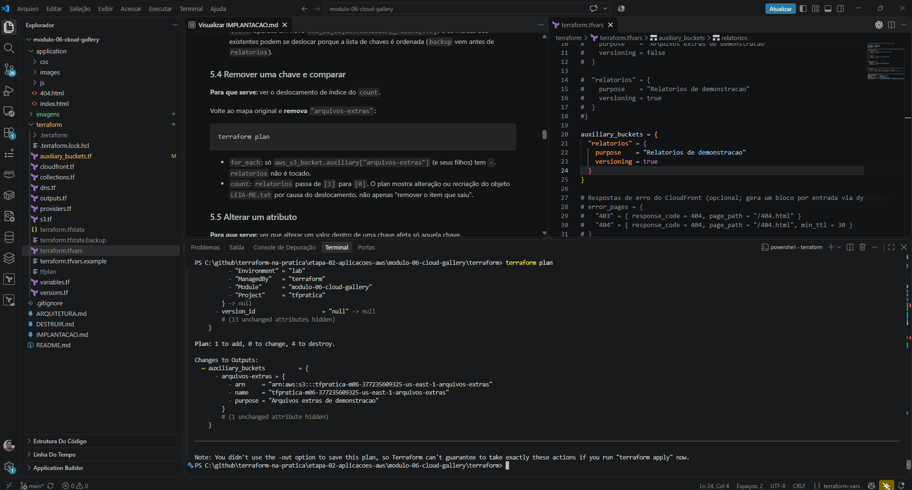

*Figura 5 — Plan ao remover uma chave do for_each: apenas um recurso removido.*

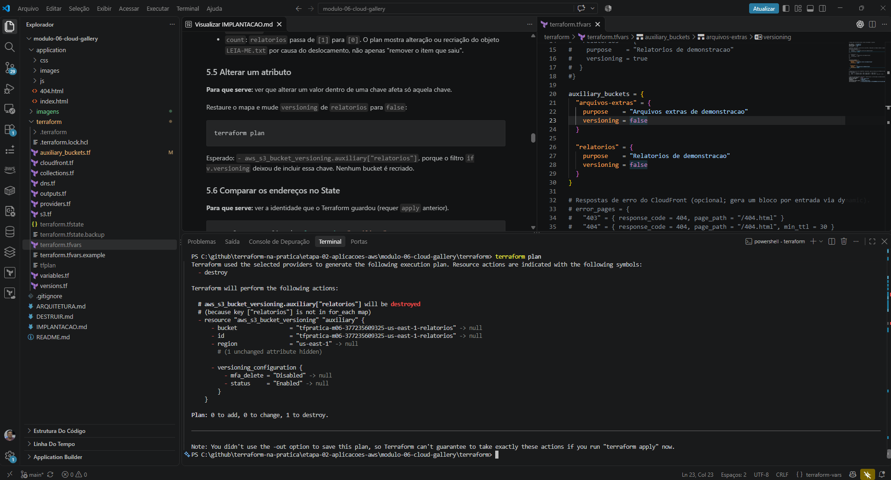

*Figura 6 — Plan ao alterar um atributo: atualização em lugar, sem recriar.*

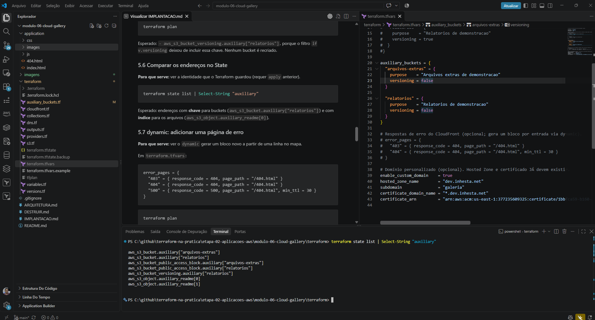

*Figura 7 — terraform state list: endereços identificados por chave.*

## Expressões for

Todas em `collections.tf`, calculadas no `plan`. Resultados reais obtidos com `terraform console`:

| Padrão | Expressão (resumo) | Resultado |
|---|---|---|
| lista → lista, com filtro | `[for f in local.site_files : f if startswith(f, "images/")]` | 12 caminhos de imagem |
| lista → lista de objetos | `{ file = f, category = split("-", basename(f))[0] }` | categoria extraída do nome do arquivo |
| lista → mapa | `{ for img in ... : img.file => img.category }` | arquivo → categoria |
| lista → mapa agrupado | `{ for img in ... : img.category => img.file... }` | categoria → lista de arquivos |
| mapa → mapa | `{ for c, files in ... : c => length(files) }` | 3 imagens em cada categoria |
| mapa → lista | `sort(keys(local.category_counts))` | `abstrato`, `cidade`, `natureza`, `tecnologia` |

Os três pontos (`...`) mudam o comportamento da chave repetida: sem eles o Terraform acusa chave duplicada; com eles os valores são agrupados em uma lista.

## dynamic: blocos repetidos a partir de uma coleção

Um bloco aninhado, como `custom_error_response`, não aceita `for_each`. O `dynamic` resolve isso:

```hcl
dynamic "custom_error_response" {
  for_each = var.error_pages

  content {
    error_code         = tonumber(custom_error_response.key)
    response_code      = custom_error_response.value.response_code
    response_page_path = custom_error_response.value.page_path
  }
}
```

O Terraform gera um bloco por entrada de `var.error_pages`. Adicionar um código de erro é adicionar uma linha no mapa, sem duplicar código. O iterador (`custom_error_response.key` e `.value`) tem o nome do próprio bloco.

O módulo também usa `dynamic` como interruptor em `viewer_certificate`: uma lista de zero ou um elemento liga ou desliga o bloco, conforme o domínio personalizado esteja ou não habilitado.

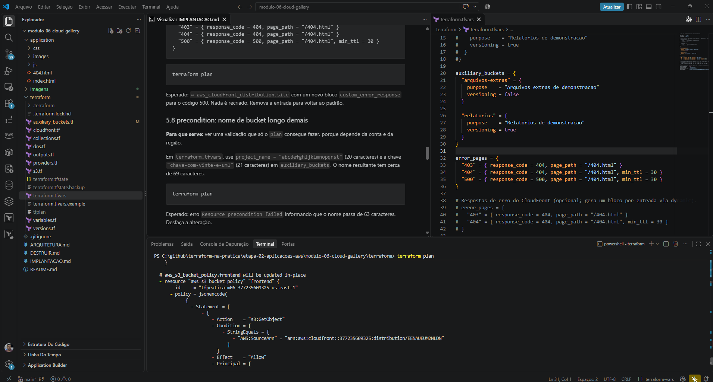

*Figura 8 — Plan do bloco dynamic adicionando uma página de erro.*

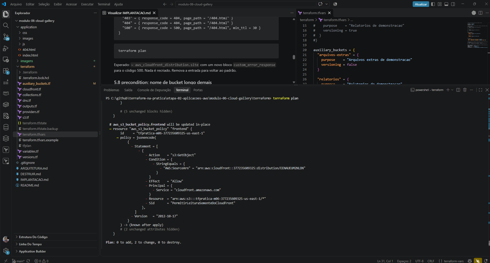

*Figura 9 — Resumo do plan com as páginas de erro geradas pelo dynamic.*

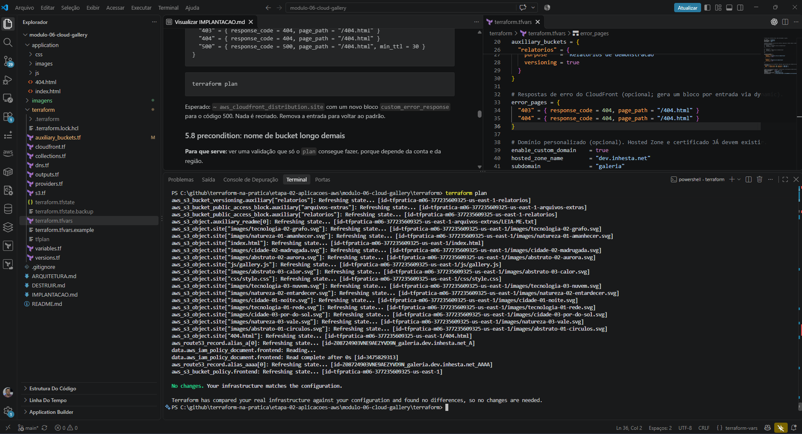

*Figura 10 — Plan sem mudanças após retornar à configuração original.*

## lifecycle: o que está ativo e o que é exemplo

| Argumento | Situação | Onde |
|---|---|---|
| `ignore_changes = [tags["CostCenter"]]` | **ativo** | `aws_s3_bucket.frontend` (`s3.tf`) |
| `precondition` (certificado, região, cobertura do nome) | **ativo** | `aws_cloudfront_distribution.site` |
| `precondition` (nome do bucket com até 63 caracteres) | **ativo** | `aws_s3_bucket.auxiliary` |
| `prevent_destroy = true` | **comentado** (travaria o `destroy` do laboratório; o valor precisa ser literal) | `s3.tf` |
| `create_before_destroy = true` | **comentado, como contraexemplo** (mesma chave de objeto: o apagamento do antigo removeria o novo) | `auxiliary_buckets.tf` |

O uso correto de `create_before_destroy` está no módulo 05, com o Security Group.

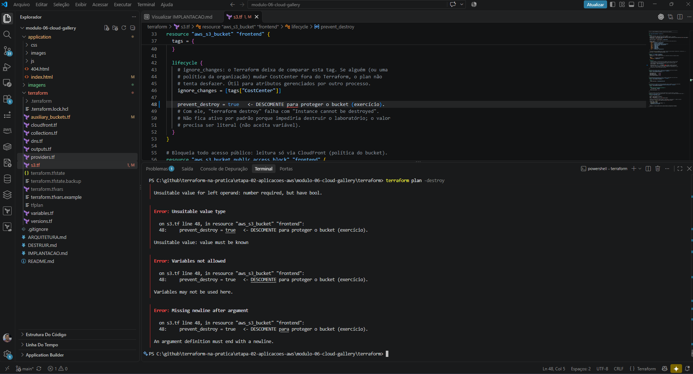

*Figura 11 — Erro de sintaxe ao descomentar o prevent_destroy de forma incorreta.*

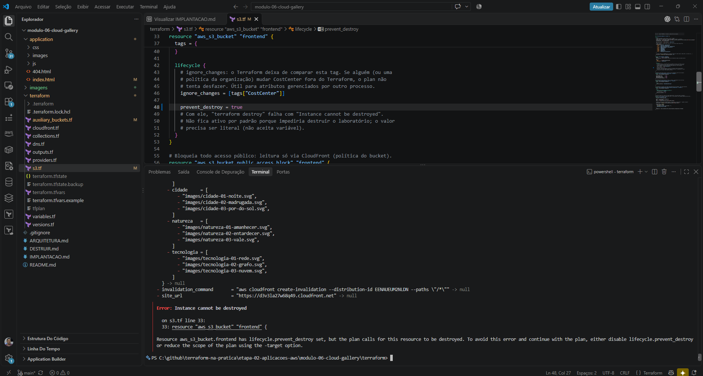

*Figura 12 — Bloqueio do destroy causado por prevent_destroy.*

## Arquitetura resumida

Bucket S3 privado, acessível só pelo CloudFront via OAC, com HTTPS. A policy do bucket libera `s3:GetObject` apenas para esta distribuição. Dois buckets auxiliares existem somente para estudar coleções. Domínio próprio é opcional e reutiliza Hosted Zone e certificado ACM já existentes, sem criá-los.

Recursos com os valores padrão: 30. Detalhes em [ARQUITETURA.md](ARQUITETURA.md).

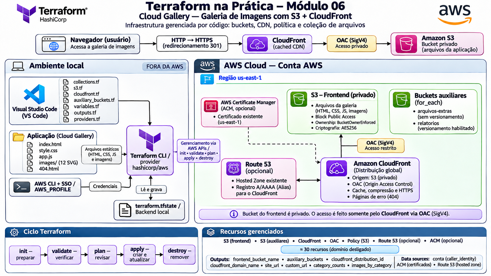

*Figura 13 — Arquitetura do Módulo 06: S3 privado, CloudFront com OAC e domínio opcional (Route 53 e ACM).*

## Resultado esperado

- A galeria abre em HTTPS com 12 imagens, filtros e busca.
- `terraform state list` mostra endereços por chave (`["relatorios"]`) para os buckets e por índice (`[0]`) para os arquivos LEIA-ME.
- `terraform output category_counts` mostra 3 imagens por categoria, calculadas pelo Terraform a partir dos nomes dos arquivos.
- Adicionar ou remover uma chave de `auxiliary_buckets` altera somente o que a chave representa.


*Figura 14 — Galeria publicada acessada pela URL do CloudFront.*

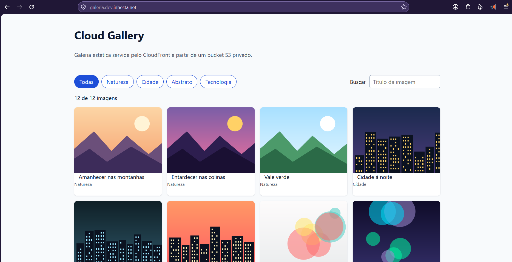

*Figura 15 — Galeria acessada pelo domínio personalizado.*

## Principais aprendizados

- A identidade de uma cópia define o que o `plan` faz: posição (`count`) ou chave (`for_each`).
- `for_each` exige `map` ou `set`; listas precisam de `toset()`.
- `map(object({...}))` entrega coleções tipadas e validáveis.
- Expressões `for` convertem entre listas e mapas e agrupam com `...`.
- `dynamic` evita repetir blocos aninhados.
- `lifecycle` muda o comportamento do Terraform, e nem todo argumento serve para todo recurso.

## Documentos deste módulo

| Documento | Conteúdo |
|---|---|
| [ARQUITETURA.md](ARQUITETURA.md) | Serviços AWS, recursos Terraform e relações entre os blocos |
| [IMPLANTACAO.md](IMPLANTACAO.md) | Passo a passo guiado, com verificações e testes |
| [DESTRUIR.md](DESTRUIR.md) | Remoção segura |